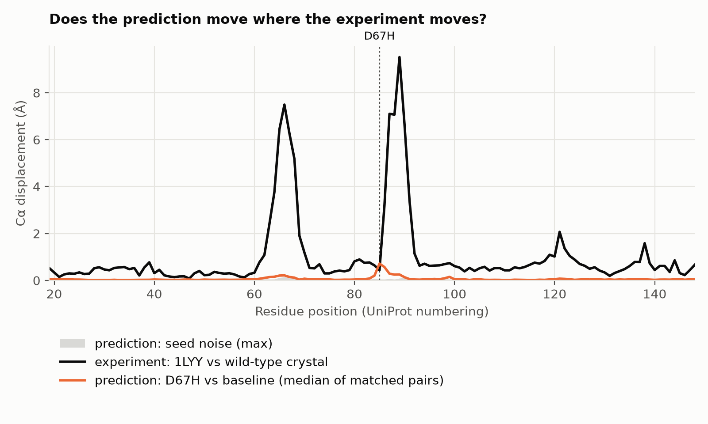

# From experiment 001 to a sixth-semester biomedicine project

How the ubiquitin experiment in this repo maps onto a project a sixth-semester
student of the Licenciatura en Biomedicina (terminal area Fisiología) could do,
most naturally inside **Trabajo de Investigación**.

## What experiment 001 is, as a template

Strip away the protein and it is this skeleton, which is the same one a thesis uses:

1. A question that a number can answer.
2. A positive control that shows the method works on a known case.
3. A measured noise floor.
4. One variable changed.
5. A decision rule fixed in advance.
6. A result, including when the result is "no difference".
7. A statement of what the experiment cannot tell you, and what would.

A student project keeps the skeleton and the pipeline, and changes the protein, the
mutation and the question.

## What experiment 001 taught, and why it shapes the student project

The predictor reproduced the crystal structure of wild-type ubiquitin to 0.38 Å.
Then it predicted the same structure, with the same confidence, for a mutant that
has three of four side-chain carbons deleted from the middle of its core: the
backbone moved by 0.085 Å and pLDDT at the site went from 98.1 to 97.8. Full
account in the [notebook](../experiments/001-ubiquitin-L67A/NOTEBOOK.md).

Two consequences for anyone designing a project on top of this:

1. **"Does the mutation lower pLDDT?" is a poor question.** It was the question in
   the original plan, and for a single mutation in a well-folded protein the
   answer is almost always no, whatever the mutation does in reality. A student
   who only asks that will get a flat line and nothing to discuss.
2. **A good project needs an answer to compare against.** Experiment 001 could not
   say whether the prediction for the mutant was right, because nobody has put an
   L67A structure in the PDB. Experiment 002, below, fixes exactly that.

## Where it sits in the curriculum

By sixth semester the student has the biology and none of the statistics, and the
project is designed around that.

| Already taken | What it contributes |
|---|---|
| Bioquímica I-II | Amino acids, levels of protein structure, the hydrophobic effect: why a core mutation matters |
| Fisicoquímica | Free energy: why "same shape" and "less stable" are both possible at once |
| Biología Celular | What the protein does in the cell (for ubiquitin: tagging proteins for the proteasome) |
| Biología Molecular I, Genética | Missense mutations, variants, why conserved positions are conserved |
| Metodología de la Investigación; Historia y Filosofía de la Ciencia | Falsifiable hypotheses, controls |
| Introducción al Laboratorio de Investigación I-II | Keeping a lab notebook; here it is `NOTEBOOK.md` |
| Fisiología I-II, Farmacología, Inmunología, Microbiología | The source of a protein worth asking about |

| This semester | Role in the project |
|---|---|
| Trabajo de Investigación | The project itself: protocol, execution, written report |
| Computación | Running the pipeline, reading `experiment.toml`, modifying a small Python function |
| Fisiología Avanzada | Choosing a protein whose malfunction has a physiological consequence |
| Cálculo I, Física General | Background for distances, energies and RMSD; nothing here needs more than a square root |

| Still ahead | Consequence for the design |
|---|---|
| Probabilidad (7th), Estadística (8th) | No p-values. Medians, ranges and a noise floor only, which is what the pipeline reports |
| Biofísica I-II (7th-8th), Bioquímica Integrativa (7th) | Stability (ΔΔG) and molecular dynamics are the natural *next* step, not part of this one |
| Investigación y Tesis I-IV (7th-10th) | A good sixth-semester project is a pilot: it ends with a hypothesis worth a thesis and a wet-lab experiment |

## The worked example: the two amyloid mutations of human lysozyme

Run as [experiment 002](../experiments/002-lysozyme-amyloid/README.md); the
[notebook](../experiments/002-lysozyme-amyloid/NOTEBOOK.md) has the full account.
It is the model for a student project, and the starting point for one.

**Why this protein.** Lysozyme is a 130-residue enzyme in tears, saliva and
macrophages. Two inherited single mutations, I56T and D67H, make it deposit as
amyloid in liver, kidney and spleen (hereditary systemic amyloidosis). It is a
physiology question with a molecular cause.

**Why it is a better test than ubiquitin.** Crystal structures exist for the wild
type *and for both mutants* (PDB 1LZ1, 1LOZ, 1LYY), so each mutant prediction can
be scored against an experimental answer. And the two answers differ: I56T leaves
the crystal structure untouched (0.28 Å), while D67H swings two loops by up to
9.5 Å.

**Question.** Does AlphaFold2 predict a structural change for D67H and none for
I56T, as crystallography shows?

**What came out.**

| | I56T | D67H |
|---|---|---|
| Crystal: how far the structure moves from wild type | 0.28 Å overall, nothing above 1 Å | two loops, 6.3 Å (up to 9.5) |
| Prediction: how far it moves from the wild-type prediction | 0.08 Å | 0.11 Å overall, 0.16 Å in those loops |
| Mutant prediction's distance from the wild-type crystal | 0.40 Å | 0.38 Å |
| Mutant prediction's distance from the mutant's own crystal | 0.45 Å | 1.83 Å (5.8 Å in the loops) |
| Confidence (mean pLDDT) | 98.1 | 98.0 |

AlphaFold2 was right about I56T and wrong about D67H, and for the same reason: it
returned the wild-type structure both times, with full confidence. All three
crystal structures were in its training data. It did respond faintly to D67H, in
the right loops, about forty times too weakly.

**The numbering trap, on purpose.** Papers call the mutations I56T and D67H,
counting from the first residue of the mature enzyme. UniProt counts from the
precursor, 18 residues earlier, so the same mutations are I74T and D85H there.
Getting this wrong is one of the most common real errors in the field, and the
pipeline refuses to run if the letters do not match.

**Cost.** Thirty predictions of 130 residues took about half an hour on the remote
GPU PC, running ten at a time.

## What the student does with it

Reproducing experiment 002 is weeks 1-2, not the project. The project is one
question that 002 leaves open. Each of these keeps the same skeleton. The first
three now have a full protocol and are prepared to the point where running them
is one command; see [the next three experiments](next-experiments.md).

1. **Does a tool built for the question do better?** AlphaFold2 could not tell a
   harmful mutation from a harmless one. Score mutations with tools made for that
   and compare with a laboratory measurement. Lysozyme has too few documented
   variants for this, so the protocol uses ubiquitin, where 1,195 mutants have
   been measured:
   [experiment 003](../experiments/003-ubiquitin-variant-effect/README.md).
2. **Is it the same with more mutants?** Two mutations are an anecdote. Phage T4
   lysozyme has hundreds of mutant crystal structures in the PDB. Pick ten, half
   that move the backbone and half that do not, and measure how often the
   prediction follows the experiment. This turns the result into a rate, with a
   table and a plot, using descriptive statistics only:
   [experiment 005](../experiments/005-t4-lysozyme-panel/README.md). The best fit
   for a student.
3. **Does letting the network look at known structures change the answer?** 002
   ran without templates. Rerun it with templates on and compare. A one-setting
   change with a clear outcome; good for a short project:
   [experiment 004](../experiments/004-lysozyme-templates/README.md).
4. **Bring it to physiology.** Apply the same design to a protein from Fisiología
   Avanzada whose mutant has a crystal structure, chosen by the student. The
   criteria: under about 250 residues, single chain, wild-type and mutant
   structures both in the PDB.

The Computación part of any of these is small and real: reading the comparison
functions in `foldlab/structure.py` and adding one measurement of the student's
own to `foldlab/analyze.py`.

## Two alternatives

**Sickle-cell haemoglobin (HBB E6V; E7V in UniProt numbering, P68871, reference
2HHB chain B).** The textbook physiology mutation. It is on the surface, does not
change the fold, and causes disease by making haemoglobin molecules stick to each
other. Predicted as a single chain, nothing should change, and the student's job
is to explain why a prediction of one chain *cannot* see this mechanism. Simple to
run; the interest is all in the reasoning. Good paired with a buried mutation as
contrast.

**TEM-1 β-lactamase resistance mutations (P62593, reference 1BTL).** For the
Microbiología terminal area. Mutations such as E104K and G238S extend the enzyme
to newer antibiotics, and published deep mutational scans measured the effect of
nearly every single mutation. The student can correlate conservation from the MSA
with measured fitness, which is a quantitative result. Two cautions: β-lactamase
papers use their own residue numbering (Ambler), which matches neither UniProt nor
a simple offset, and at 263 residues the predictions need a GPU (Colab).

## A semester plan

| Weeks | Work | Product |
|---|---|---|
| 1-2 | Read `README.md` and `docs/concepts.md`. Rerun experiments 001 and 002 and reproduce their numbers | Notebook entry: "my numbers match / differ because..." |
| 3 | Choose the protein. Read its UniProt entry and one review | One page: protein, disease, mutations, what is known |
| 4 | Write the experiment `README.md`: question, hypotheses, decision rule | The protocol, reviewed by the advisor *before* running |
| 5-6 | Run the pipeline. Check the positive control before looking at mutants | Predictions, `REPORT.md` |
| 7-8 | Add one measurement of your own to the analysis. Look at the structures in the viewer | New figure and table |
| 9 | Second opinion from a different kind of tool (a stability or variant-effect predictor) | Comparison table: does it agree? |
| 10-11 | Write: introduction, methods, results, limitations, proposed wet-lab experiment | Report |
| 12 | Present | Talk |

## Deliverables

| Deliverable | Where it comes from |
|---|---|
| A falsifiable question and decision rule | experiment `README.md`, written first |
| Wild-type and mutant sequences | `inputs/*.fasta` |
| Predicted structures | `predictions/`, `results/aligned/*.pdb` |
| Table of pLDDT and RMSD against noise | `results/REPORT.md`, `results/*.csv` |
| Structure figure coloured by confidence | screenshot of `results/viewer.html` |
| Record of every run | `results/provenance.json`, `NOTEBOOK.md` |
| Limitations and next experiment | `NOTEBOOK.md`, written by the student |

## What a good report shows

- The control was checked before the mutants were interpreted.
- Every difference is stated next to the noise it was compared with.
- "The prediction suggests" and never "the mutation causes".
- The mechanism of disease that a structure prediction *cannot* address is named.
  For lysozyme, the accepted explanation (Booth et al., *Nature* 1997) is that
  amyloid forms from partially unfolded molecules: the cause is lost stability,
  not the folded shape. The student should read that paper and check this claim.
- A proposed experiment that would settle it: express the variant, measure its
  melting temperature against wild type.

## Where a conversational AI fits

Three places, none of them as the source of biological truth:

1. **Design.** "Here is my question and my protein. What controls am I missing?
   What result would prove me wrong?"
2. **Code.** "Write a function that overlays a predicted mutant on its crystal
   structure and reports per-residue Cα displacement, using `foldlab/structure.py`."
3. **Interpretation under challenge.** "Here are my numbers and my conclusion.
   Which sentences claim more than the data supports?"

The student, not the assistant, checks every factual claim about the protein
against UniProt, the PDB entry and the cited paper.
