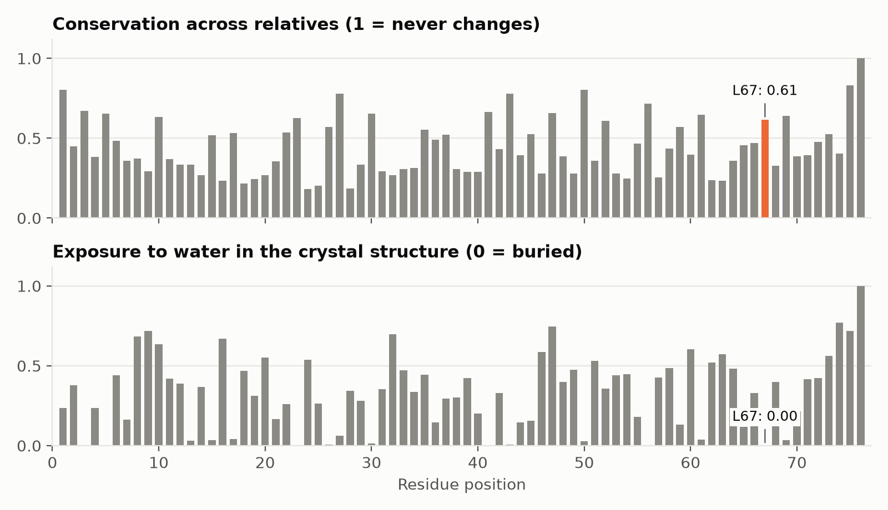
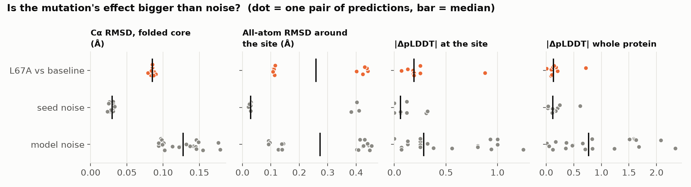
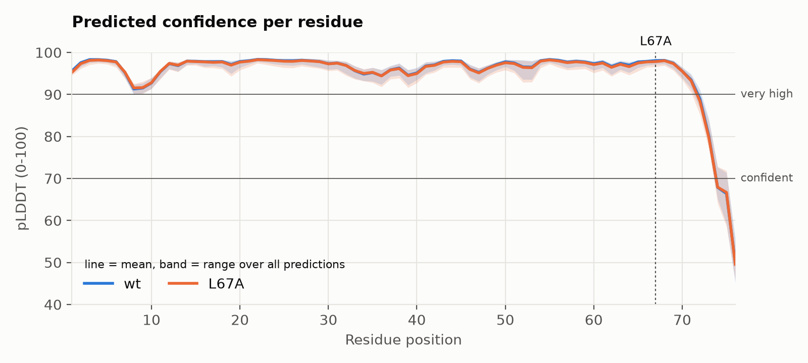
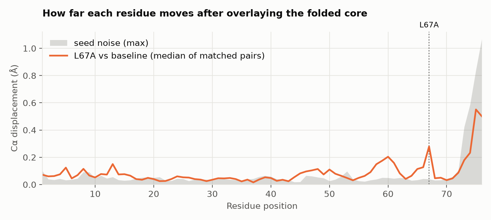

# Results: 001-ubiquitin-L67A

Generated by `foldlab report` from the files in `results/`. Do not edit by hand: interpretation belongs in `NOTEBOOK.md`.

**Question.** Does replacing the buried core leucine 67 of human ubiquitin with alanine change the structure or the confidence that AlphaFold2 predicts?

## Does the predictor work on this protein? (positive control)

Each prediction is overlaid on the experimental structure 1UBQ using the Cα atoms of residues 1-72. Values are median (min-max) over all predictions of that variant.

| Variant | Predictions | Mean pLDDT | Lowest pLDDT | pTM | Cα RMSD to 1UBQ (Å) |
|---|---|---|---|---|---|
| wt | 10 | 95.3 (93.7-96.0) | 47.9 (45.1-55.8) | 0.83 (0.80-0.84) | 0.38 (0.36-0.42) |
| L67A | 10 | 95.3 (93.2-95.9) | 47.4 (45.7-54.2) | 0.83 (0.79-0.84) | 0.40 (0.38-0.43) |

## L67A: why this site?

| Residue | Same amino acid in relatives | Most common substitutions | Relatives that carry the new amino acid | Conservation (0-1) | Conservation rank | Exposure to water (0-1) |
|---|---|---|---|---|---|---|
| L67 | 59% | I:22% V:14% F:2% | A: 0.2% | 0.61 | 17 of 76 | 0.00 |

Alignment depth: 20566 unique sequences. Residues within 6.0 Å of the site in 1UBQ: 3, 4, 5, 6, 7, 23, 26, 43, 44, 45, 50, 56, 61, 65, 66, 68, 69.

Closest side-chain approach to known functional residues:

- Ile44 hydrophobic patch (binds most partners): 3.8 Å
- Lys48 (chain linkage: degradation signal): 9.8 Å
- Lys63 (chain linkage: signalling): 9.5 Å
- Gly76 C-terminus (attaches to substrates): 25.4 Å

## L67A vs wt: effect against noise

Decision rule (fixed in advance): the mutation shows up in a metric only if the median over matched pairs is larger than the largest value seen between two seeds of the same sequence.

| Metric | Mutation, median (min-max) | Seed noise, median (min-max) | Model noise, median (min-max) | Verdict |
|---|---|---|---|---|
| Cα RMSD, folded core (Å) | 0.09 (0.08-0.09) | 0.03 (0.02-0.03) | 0.13 (0.09-0.18) | **above noise** |
| All-atom RMSD around the site (Å) | 0.26 (0.11-0.44) | 0.03 (0.02-0.41) | 0.27 (0.09-0.46) | within noise |
| \|ΔpLDDT\| at the site | 0.19 (0.07-0.88) | 0.06 (0.00-0.32) | 0.28 (0.00-1.25) | within noise |
| \|ΔpLDDT\| whole protein | 0.13 (0.01-0.72) | 0.12 (0.01-0.61) | 0.77 (0.01-2.34) | within noise |

Signed change in pLDDT, L67A minus wt (median of matched pairs): -0.19 at the site, -0.10 over the whole protein.

## Provenance

- ColabFold 1.6.3, AlphaFold2 weights `alphafold_params_2021-07-14 (AlphaFold2-ptm)`, JAX 0.11.2, Python 3.12.16, macOS-26.4.1-arm64-arm-64bit
- Settings: model_type=alphafold2_ptm, msa_mode=mmseqs2_uniref_env, num_models=5, num_recycle=3, num_seeds=2, random_seed=0
- Every variant used the same alignment; only the query row differs (see `msa/`).
- 3D view: open `results/viewer.html` in a browser.
