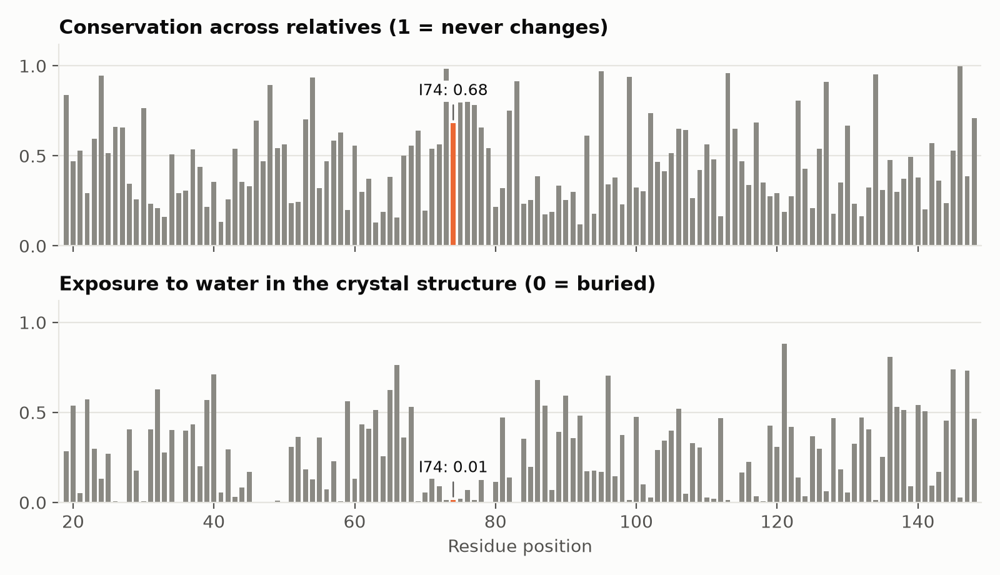
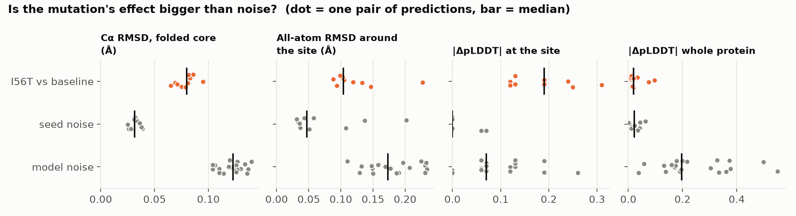
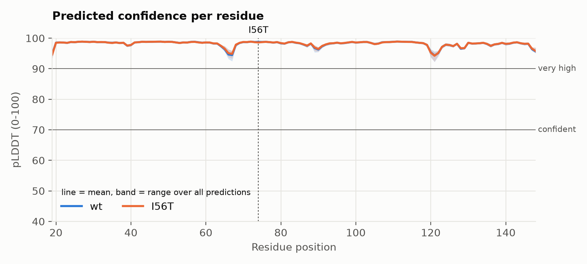
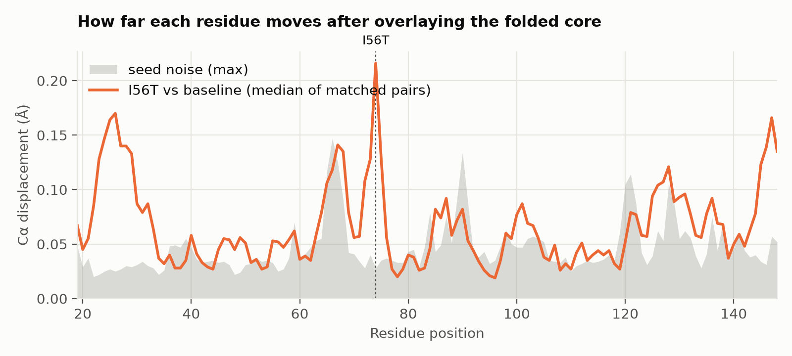
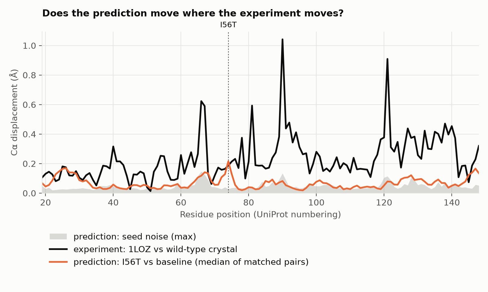
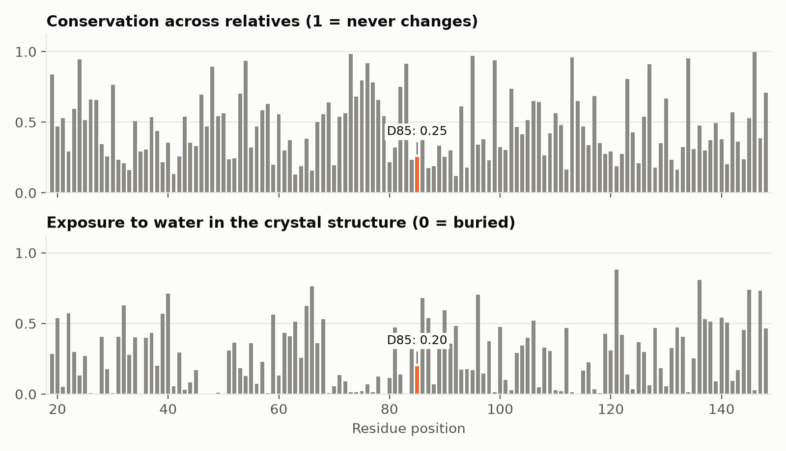
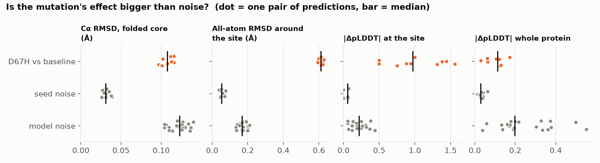
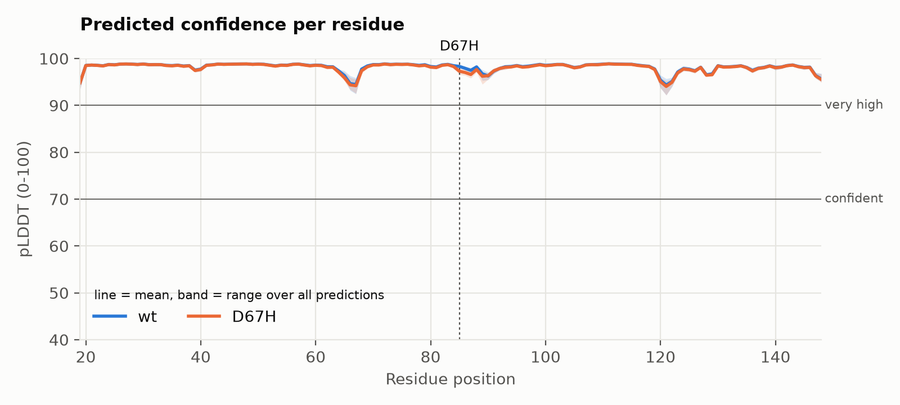
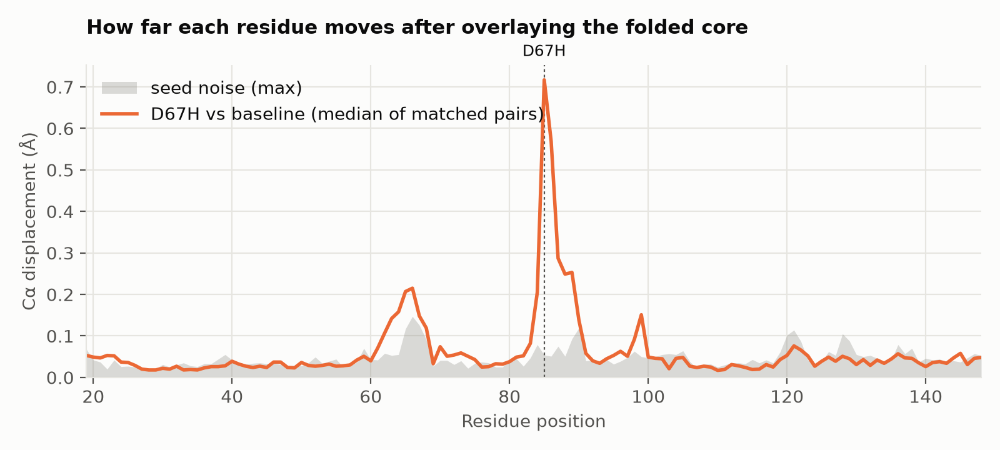
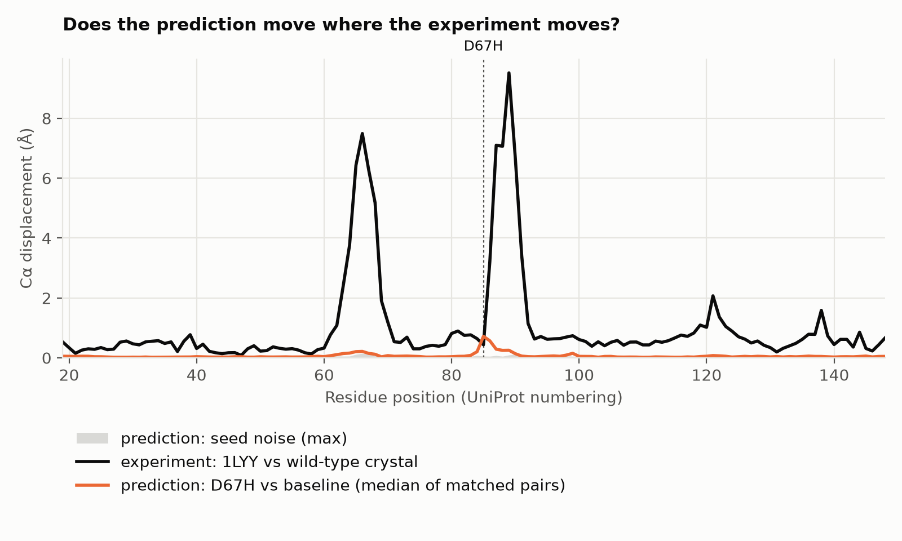

# Results: 002-lysozyme-amyloid

Generated by `foldlab report` from the files in `results/`. Do not edit by hand: interpretation belongs in `NOTEBOOK.md`.

**Question.** Two mutations of human lysozyme cause hereditary amyloidosis. Crystallography shows that one (D67H) moves two loops by several ångströms and the other (I56T) moves almost nothing. Does AlphaFold2 predict that difference?

## Does the predictor work on this protein? (positive control)

Each prediction is overlaid on the experimental structure 1LZ1 using the Cα atoms of residues 19-148. Values are median (min-max) over all predictions of that variant.

| Variant | Predictions | Mean pLDDT | Lowest pLDDT | pTM | Cα RMSD to 1LZ1 (Å) |
|---|---|---|---|---|---|
| wt | 10 | 98.1 (97.9-98.4) | 93.4 (92.2-95.4) | 0.91 (0.90-0.92) | 0.41 (0.39-0.42) |
| I56T | 10 | 98.1 (97.9-98.4) | 93.6 (92.3-95.5) | 0.91 (0.90-0.92) | 0.40 (0.39-0.41) |
| D67H | 10 | 98.0 (97.8-98.3) | 93.5 (92.2-95.2) | 0.91 (0.90-0.91) | 0.38 (0.37-0.40) |

## I56T: why this site?

| Residue | Same amino acid in relatives | Most common substitutions | Relatives that carry the new amino acid | Conservation (0-1) | Conservation rank | Exposure to water (0-1) |
|---|---|---|---|---|---|---|
| I74 | 51% | L:43% V:4% M:1% | T: 0.1% | 0.68 | 24 of 130 | 0.01 |

Alignment depth: 5066 unique sequences. Residues within 6.0 Å of the site in 1LZ1: 19, 21, 26, 49, 50, 51, 53, 54, 55, 56, 57, 58, 59, 60, 72, 73, 75, 76, 77, 102, 107, 110.

Closest side-chain approach to known functional residues:

- Catalytic Glu35 and Asp53 (mature numbering): 6.0 Å

## I56T vs wt: effect against noise

Decision rule (fixed in advance): the mutation shows up in a metric only if the median over matched pairs is larger than the largest value seen between two seeds of the same sequence. To count as more than detectable it must also exceed the median difference between two of AlphaFold2's networks.

| Metric | Mutation, median (min-max) | Seed noise, median (min-max) | Model noise, median (min-max) | Verdict |
|---|---|---|---|---|
| Cα RMSD, folded core (Å) | 0.08 (0.07-0.10) | 0.03 (0.03-0.04) | 0.12 (0.10-0.14) | **detectable but smaller than the difference between networks** |
| All-atom RMSD around the site (Å) | 0.10 (0.09-0.23) | 0.05 (0.03-0.20) | 0.17 (0.11-0.23) | within noise |
| \|ΔpLDDT\| at the site | 0.19 (0.12-0.31) | 0.00 (0.00-0.07) | 0.07 (0.00-0.26) | **above noise and above the difference between networks** |
| \|ΔpLDDT\| whole protein | 0.02 (0.01-0.10) | 0.02 (0.00-0.06) | 0.20 (0.04-0.55) | within noise |

Signed change in pLDDT, I56T minus wt (median of matched pairs): -0.19 at the site, +0.02 over the whole protein.

## I56T: prediction against the mutant's own crystal structure (1LOZ)

What the experiment shows: overlaid on 1LZ1, the crystal structure of I56T differs by 0.28 Å (Cα RMSD), with the largest shift, 1.0 Å, at residue 90. No residue moves more than 2 Å.

What the prediction shows: the largest shift between matched wt and I56T predictions is 0.22 Å, at residue 74.

| Cα RMSD over the whole protein, median (min-max), Å | vs 1LZ1 (wt crystal) | vs 1LOZ (I56T crystal) |
|---|---|---|
| wt predictions | 0.41 (0.39-0.42) | 0.46 (0.46-0.47) |
| I56T predictions | 0.40 (0.39-0.41) | 0.45 (0.45-0.46) |

## D67H: why this site?

| Residue | Same amino acid in relatives | Most common substitutions | Relatives that carry the new amino acid | Conservation (0-1) | Conservation rank | Exposure to water (0-1) |
|---|---|---|---|---|---|---|
| D85 | 32% | N:14% S:13% P:9% | H: 5.7% | 0.25 | 103 of 130 | 0.20 |

Alignment depth: 5066 unique sequences. Residues within 6.0 Å of the site in 1LZ1: 68, 69, 70, 72, 79, 83, 84, 86, 87, 88, 91, 97, 98, 99.

Closest side-chain approach to known functional residues:

- Catalytic Glu35 and Asp53 (mature numbering): 7.6 Å

## D67H vs wt: effect against noise

Decision rule (fixed in advance): the mutation shows up in a metric only if the median over matched pairs is larger than the largest value seen between two seeds of the same sequence. To count as more than detectable it must also exceed the median difference between two of AlphaFold2's networks.

| Metric | Mutation, median (min-max) | Seed noise, median (min-max) | Model noise, median (min-max) | Verdict |
|---|---|---|---|---|
| Cα RMSD, folded core (Å) | 0.11 (0.10-0.12) | 0.03 (0.03-0.04) | 0.12 (0.10-0.14) | **detectable but smaller than the difference between networks** |
| All-atom RMSD around the site (Å) | 0.61 (0.59-0.63) | 0.05 (0.04-0.08) | 0.17 (0.13-0.21) | **above noise and above the difference between networks** |
| \|ΔpLDDT\| at the site | 0.97 (0.50-1.56) | 0.06 (0.00-0.07) | 0.22 (0.06-0.44) | **above noise and above the difference between networks** |
| \|ΔpLDDT\| whole protein | 0.11 (0.03-0.17) | 0.03 (0.01-0.06) | 0.20 (0.04-0.55) | **detectable but smaller than the difference between networks** |

Signed change in pLDDT, D67H minus wt (median of matched pairs): -0.97 at the site, -0.11 over the whole protein.

## D67H: prediction against the mutant's own crystal structure (1LYY)

What the experiment shows: overlaid on 1LZ1, the crystal structure of D67H differs by 1.94 Å (Cα RMSD), with the largest shift, 9.5 Å, at residue 89. Residues that move more than 2 Å: 63, 64, 65, 66, 67, 68, 86, 87, 88, 89, 90, 91, 121.

What the prediction shows: the largest shift between matched wt and D67H predictions is 0.72 Å, at residue 85.

| Over the residues that move in the experiment | Median (min-max), Å |
|---|---|
| Shift between the two crystal structures | 6.28 (2.07-9.52) |
| Shift between wt and D67H predictions | 0.16 (0.06-0.57) |
| Largest seed noise there | 0.09 (0.04-0.15) |
| D67H predictions, distance from the wt crystal | 0.79 (0.73-0.88) |
| D67H predictions, distance from the D67H crystal | 5.76 (5.72-5.94) |

| Cα RMSD over the whole protein, median (min-max), Å | vs 1LZ1 (wt crystal) | vs 1LYY (D67H crystal) |
|---|---|---|
| wt predictions | 0.41 (0.39-0.42) | 1.80 (1.78-1.83) |
| D67H predictions | 0.38 (0.37-0.40) | 1.82 (1.81-1.88) |

## Provenance

- ColabFold 1.6.3, AlphaFold2 weights `alphafold_params_2021-07-14 (AlphaFold2-ptm)`, JAX 0.11.2, Python 3.12.16, macOS-26.4.1-arm64-arm-64bit
- Settings: model_type=alphafold2_ptm, msa_mode=mmseqs2_uniref_env, num_models=5, num_recycle=3, num_seeds=2, random_seed=0
- Every variant used the same alignment; only the query row differs (see `msa/`).
- 3D view: open `results/viewer.html` in a browser.
