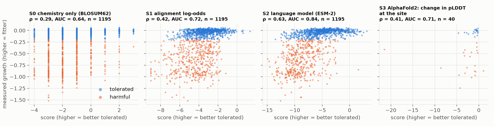
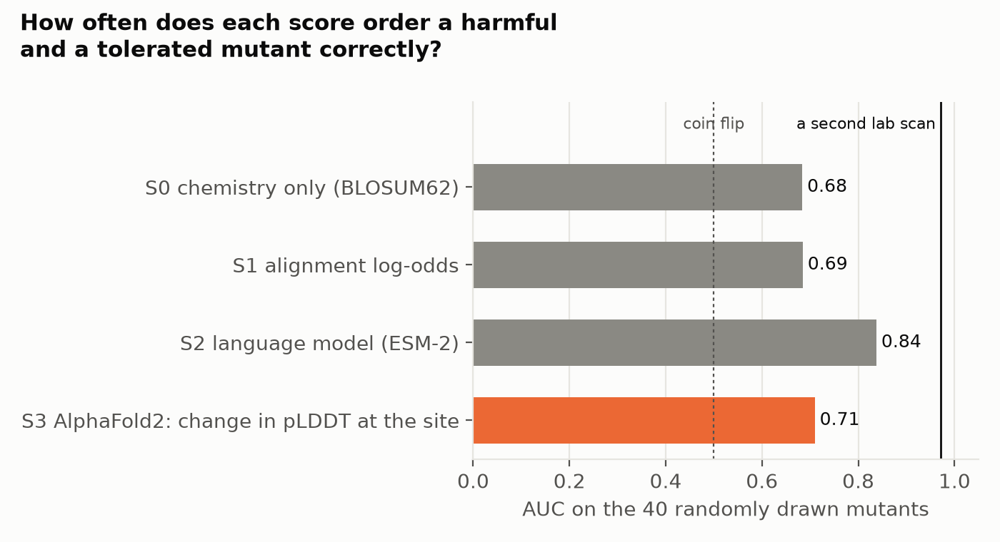

# Results: 003-ubiquitin-variant-effect

Generated by `foldlab report`. Interpretation belongs in `NOTEBOOK.md`.

**Question.** Which score agrees with the measured effect of ubiquitin's mutations: AlphaFold2's confidence, or scores built from evolution?

Measured scan: `RL40A_YEAST_Roscoe_2013`, 1195 single mutants, 437 of them harmful. Structure predictions were made for a random sample of 40.

## Agreement with the laboratory

ρ: rank correlation with measured growth. AUC: how often the score orders a harmful and a tolerated mutant correctly (0.5 = coin flip).

| Score | All mutants: ρ | AUC | n | Random sample: ρ | AUC | n |
|---|---|---|---|---|---|---|
| S0 chemistry only (BLOSUM62) | 0.29 | 0.64 | 1195 | 0.39 | 0.68 | 40 |
| S1 alignment log-odds | 0.42 | 0.72 | 1195 | 0.38 | 0.69 | 40 |
| S2 language model (ESM-2) | 0.63 | 0.84 | 1195 | 0.71 | 0.84 | 40 |
| S3 AlphaFold2: change in pLDDT at the site | - | - | - | 0.41 | 0.71 | 40 |
| AlphaFold2: change in mean pLDDT | - | - | - | 0.57 | 0.78 | 40 |
| AlphaFold2: minus the Cα shift of the fold | - | - | - | 0.55 | 0.72 | 40 |
| *Ceiling: a second laboratory scan (`RL40A_YEAST_Mavor_2016`)* | 0.84 | 0.97 | 1138 | | | |

## Decision rules

- H1 evolution carries the signal (S1 AUC >= 0.70 on all mutants): **holds**
- H2 the language model does at least as well (S2 rho >= S1 rho - 0.05): **holds**
- H3 AlphaFold2's confidence does not separate them (S3 AUC < 0.65, or not above S0): **inconclusive at this sample size**

## The named cases

Percentile: where the mutant falls among all mutants on that scale (0 = the worst).

| Mutant | Measured growth | Label | S0 chemistry only (BLOSUM62) | S1 alignment log-odds | S2 language model (ESM-2) | S3 AlphaFold2: change in pLDDT at the site | AlphaFold2: change in mean pLDDT | AlphaFold2: minus the Cα shift of the fold |
|---|---|---|---|---|---|---|---|---|
| K63A | -0.05 (pct 60) | tolerated | -1.00 (pct 46) | -1.95 (pct 88) | 0.01 (pct 97) | -0.83 (pct 55) | -0.32 (pct 69) | -0.04 (pct 90) |
| L67A | -0.35 (pct 30) | harmful | -1.00 (pct 46) | -5.63 (pct 11) | -7.81 (pct 34) | -0.48 (pct 71) | -0.32 (pct 74) | -0.09 (pct 43) |
