# Results: 004-lysozyme-templates

Generated by `foldlab report` from the files in `results/`. Do not edit by hand: interpretation belongs in `NOTEBOOK.md`.

**Question.** Handed a known structure to start from, does AlphaFold2's prediction follow the sequence or the structure?

## Does the predictor work on this protein? (positive control)

Each prediction is overlaid on the experimental structure 1LZ1 using the Cα atoms of residues 19-148. Values are median (min-max) over all predictions of that variant.

| Variant | Predictions | Mean pLDDT | Lowest pLDDT | pTM | Cα RMSD to 1LZ1 (Å) |
|---|---|---|---|---|---|
| wt | 4 | 98.0 (97.9-98.1) | 93.2 (92.4-93.4) | 0.91 (0.90-0.91) | 0.41 (0.40-0.42) |
| D67H | 4 | 97.9 (97.8-98.0) | 93.4 (92.6-93.5) | 0.90 (0.90-0.91) | 0.38 (0.37-0.39) |
| I56T | 4 | 98.0 (97.9-98.1) | 93.3 (93.2-93.9) | 0.91 (0.90-0.91) | 0.40 (0.40-0.41) |
| wt_search | 4 | 98.5 (98.4-98.5) | 95.8 (95.6-96.0) | 0.92 (0.91-0.92) | 0.26 (0.26-0.27) |
| D67H_search | 4 | 98.3 (98.2-98.4) | 95.5 (95.3-95.6) | 0.92 (0.91-0.92) | 0.24 (0.24-0.25) |
| I56T_search | 4 | 98.4 (98.4-98.5) | 95.2 (95.0-95.4) | 0.92 (0.91-0.92) | 0.26 (0.26-0.26) |
| wt_1LZ1 | 4 | 98.4 (98.3-98.4) | 95.0 (94.7-95.3) | 0.91 (0.91-0.92) | 0.20 (0.20-0.22) |
| D67H_1LZ1 | 4 | 98.2 (98.2-98.3) | 94.7 (94.5-95.0) | 0.91 (0.91-0.91) | 0.20 (0.20-0.21) |
| wt_1LYY | 4 | 97.8 (97.7-97.9) | 86.0 (85.6-86.5) | 0.91 (0.90-0.91) | 0.53 (0.51-0.54) |
| D67H_1LYY | 4 | 97.3 (97.3-97.4) | 84.7 (84.1-85.4) | 0.90 (0.90-0.90) | 0.50 (0.49-0.52) |

## D67H: why this site?

| Residue | Same amino acid in relatives | Most common substitutions | Relatives that carry the new amino acid | Conservation (0-1) | Conservation rank | Exposure to water (0-1) |
|---|---|---|---|---|---|---|
| D85 | 32% | N:14% S:13% P:9% | H: 5.7% | 0.25 | 103 of 130 | 0.20 |

Alignment depth: 5066 unique sequences. Residues within 6.0 Å of the site in 1LZ1: 68, 69, 70, 72, 79, 83, 84, 86, 87, 88, 91, 97, 98, 99.

Closest side-chain approach to known functional residues:

- Catalytic Glu35 and Asp53 (mature numbering): 7.6 Å

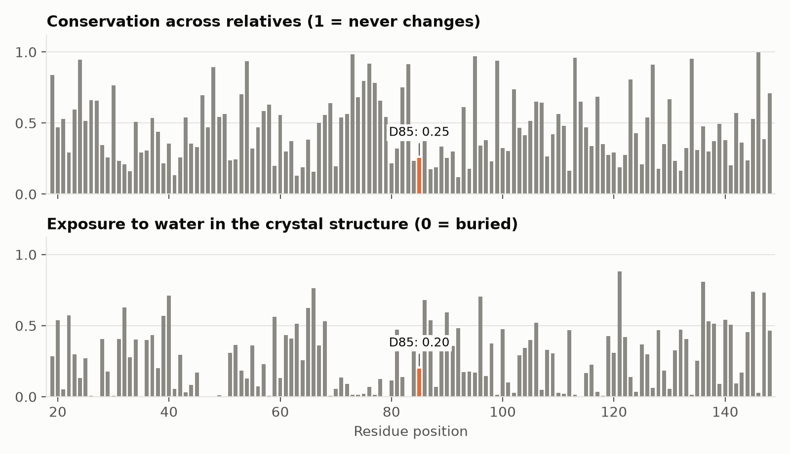

## D67H vs wt: effect against noise

Decision rule (fixed in advance): the mutation shows up in a metric only if the median over matched pairs is larger than the largest value seen between two seeds of the same sequence. To count as more than detectable it must also exceed the median difference between two of AlphaFold2's networks.

| Metric | Mutation, median (min-max) | Seed noise, median (min-max) | Model noise, median (min-max) | Verdict |
|---|---|---|---|---|
| Cα RMSD, folded core (Å) | 0.11 (0.10-0.12) | 0.03 (0.03-0.04) | 0.11 (0.10-0.11) | **above noise and above the difference between networks** |
| All-atom RMSD around the site (Å) | 0.62 (0.60-0.63) | 0.07 (0.05-0.08) | 0.16 (0.15-0.17) | **above noise and above the difference between networks** |
| \|ΔpLDDT\| at the site | 1.41 (1.31-1.56) | 0.06 (0.00-0.07) | 0.10 (0.07-0.13) | **above noise and above the difference between networks** |
| \|ΔpLDDT\| whole protein | 0.09 (0.03-0.12) | 0.04 (0.02-0.06) | 0.16 (0.14-0.18) | **detectable but smaller than the difference between networks** |

Signed change in pLDDT, D67H minus wt (median of matched pairs): -1.41 at the site, -0.09 over the whole protein.

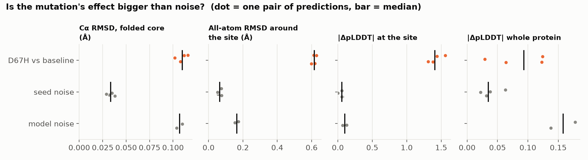

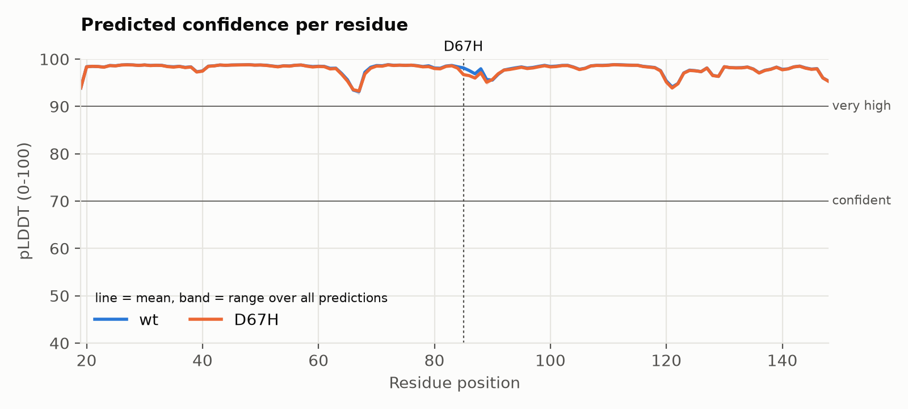

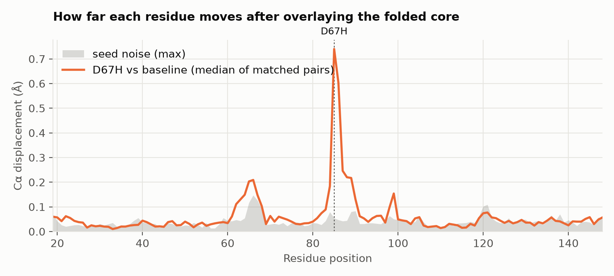

## D67H: prediction against the crystal structure 1LYY

What the experiment shows: overlaid on 1LZ1, the crystal structure 1LYY differs by 1.94 Å (Cα RMSD), with the largest shift, 9.5 Å, at residue 89. Residues that move more than 2 Å: 63, 64, 65, 66, 67, 68, 86, 87, 88, 89, 90, 91, 121.

What the prediction shows: the largest shift between matched wt and D67H predictions is 0.74 Å, at residue 85.

| Over the residues that move in the experiment | Median (min-max), Å |
|---|---|
| Shift between the two crystal structures | 6.28 (2.07-9.52) |
| Shift between wt and D67H predictions | 0.15 (0.06-0.60) |
| Largest seed noise there | 0.08 (0.03-0.15) |
| D67H predictions, distance from 1LZ1 (wt crystal) | 0.82 (0.76-0.87) |
| D67H predictions, distance from 1LYY | 5.74 (5.72-5.77) |

| Cα RMSD over the whole protein, median (min-max), Å | vs 1LZ1 (wt crystal) | vs 1LYY |
|---|---|---|
| wt predictions | 0.41 (0.40-0.42) | 1.78 (1.78-1.80) |
| D67H predictions | 0.38 (0.37-0.39) | 1.82 (1.81-1.83) |

Each prediction, over the residues that move in 1LYY (distance in Å after overlaying the residues that do not move). Verdict for this variant: **stays with the baseline crystal**.

| Network | Seed | From the wt crystal (1LZ1) | From 1LYY | Reading |
|---|---|---|---|---|
| 1 | 0 | 0.87 | 5.72 | stays with the baseline crystal |
| 1 | 1 | 0.84 | 5.75 | stays with the baseline crystal |
| 2 | 0 | 0.80 | 5.72 | stays with the baseline crystal |
| 2 | 1 | 0.76 | 5.77 | stays with the baseline crystal |

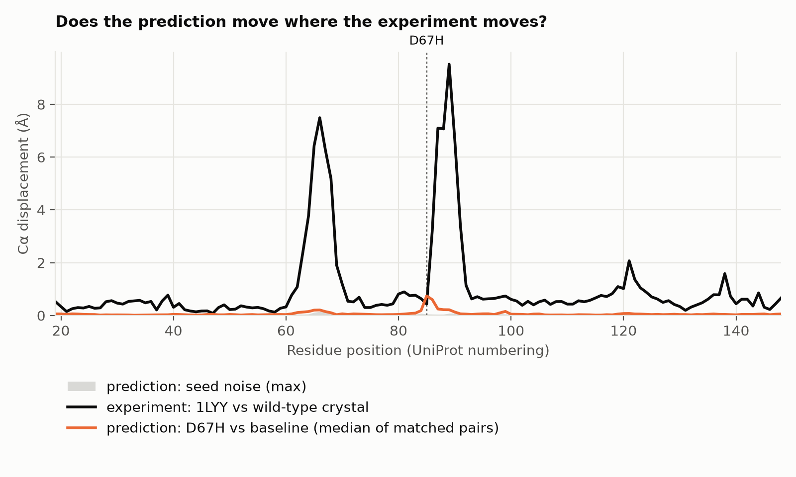

## I56T: why this site?

| Residue | Same amino acid in relatives | Most common substitutions | Relatives that carry the new amino acid | Conservation (0-1) | Conservation rank | Exposure to water (0-1) |
|---|---|---|---|---|---|---|
| I74 | 51% | L:43% V:4% M:1% | T: 0.1% | 0.68 | 24 of 130 | 0.01 |

Alignment depth: 5066 unique sequences. Residues within 6.0 Å of the site in 1LZ1: 19, 21, 26, 49, 50, 51, 53, 54, 55, 56, 57, 58, 59, 60, 72, 73, 75, 76, 77, 102, 107, 110.

Closest side-chain approach to known functional residues:

- Catalytic Glu35 and Asp53 (mature numbering): 6.0 Å

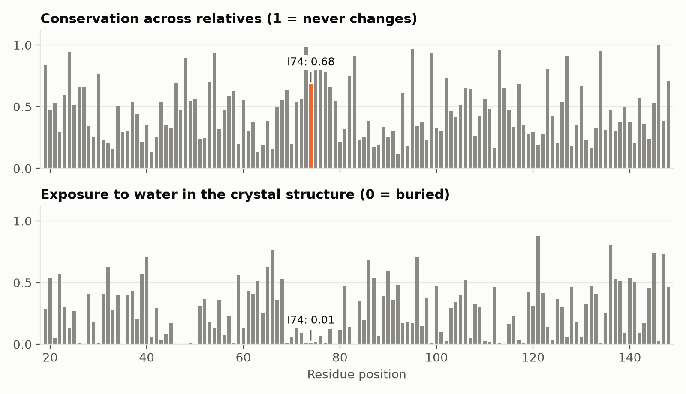

## I56T vs wt: effect against noise

Decision rule (fixed in advance): the mutation shows up in a metric only if the median over matched pairs is larger than the largest value seen between two seeds of the same sequence. To count as more than detectable it must also exceed the median difference between two of AlphaFold2's networks.

| Metric | Mutation, median (min-max) | Seed noise, median (min-max) | Model noise, median (min-max) | Verdict |
|---|---|---|---|---|
| Cα RMSD, folded core (Å) | 0.08 (0.08-0.09) | 0.04 (0.03-0.04) | 0.11 (0.10-0.11) | **detectable but smaller than the difference between networks** |
| All-atom RMSD around the site (Å) | 0.11 (0.09-0.23) | 0.05 (0.03-0.20) | 0.13 (0.13-0.13) | within noise |
| \|ΔpLDDT\| at the site | 0.18 (0.12-0.31) | 0.00 (0.00-0.07) | 0.15 (0.12-0.19) | **above noise and above the difference between networks** |
| \|ΔpLDDT\| whole protein | 0.05 (0.01-0.10) | 0.04 (0.02-0.06) | 0.16 (0.14-0.18) | within noise |

Signed change in pLDDT, I56T minus wt (median of matched pairs): -0.18 at the site, +0.05 over the whole protein.

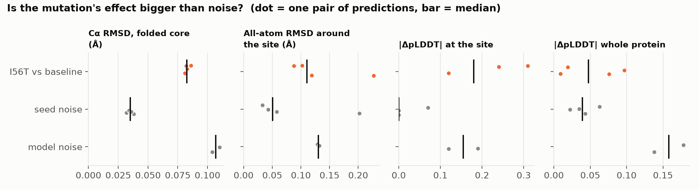

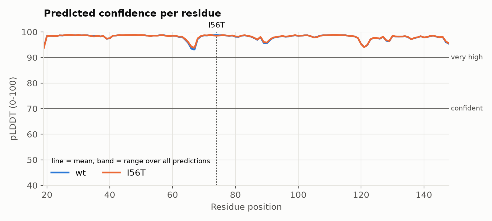

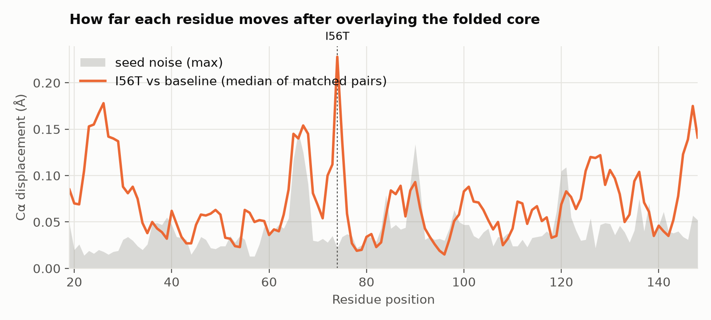

## wt_search: why this site?

| Residue | Same amino acid in relatives | Most common substitutions | Relatives that carry the new amino acid | Conservation (0-1) | Conservation rank | Exposure to water (0-1) |
|---|---|---|---|---|---|---|

Alignment depth: 5066 unique sequences. Residues within 6.0 Å of the site in 1LZ1: 19, 21, 26, 49, 50, 51, 53, 54, 55, 56, 57, 58, 59, 60, 68, 69, 70, 72, 73, 75, 76, 77, 79, 83, 84, 86, 87, 88, 91, 97, 98, 99, 102, 107, 110.

Closest side-chain approach to known functional residues:

- Catalytic Glu35 and Asp53 (mature numbering): 6.0 Å

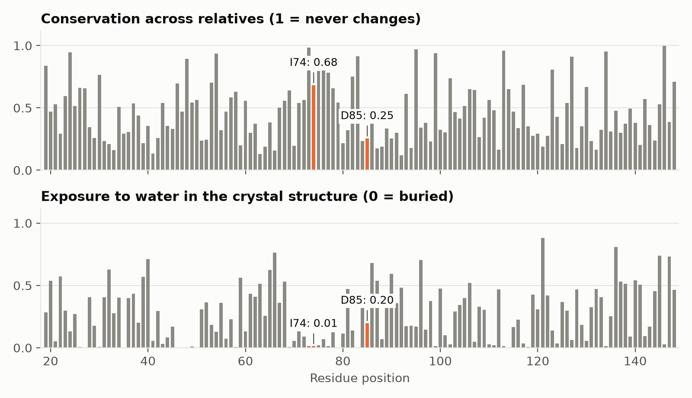

## wt_search vs wt: effect against noise

Decision rule (fixed in advance): the mutation shows up in a metric only if the median over matched pairs is larger than the largest value seen between two seeds of the same sequence. To count as more than detectable it must also exceed the median difference between two of AlphaFold2's networks.

| Metric | Mutation, median (min-max) | Seed noise, median (min-max) | Model noise, median (min-max) | Verdict |
|---|---|---|---|---|
| Cα RMSD, folded core (Å) | 0.31 (0.31-0.32) | 0.03 (0.02-0.04) | 0.11 (0.10-0.11) | **above noise and above the difference between networks** |
| All-atom RMSD around the site (Å) | 0.60 (0.55-0.65) | 0.04 (0.03-0.06) | 0.15 (0.14-0.15) | **above noise and above the difference between networks** |
| \|ΔpLDDT\| at the site | 0.28 (0.19-0.32) | 0.00 (0.00-0.07) | 0.13 (0.10-0.16) | **above noise and above the difference between networks** |
| \|ΔpLDDT\| whole protein | 0.47 (0.44-0.50) | 0.01 (0.00-0.06) | 0.16 (0.14-0.18) | **above noise and above the difference between networks** |

Signed change in pLDDT, wt_search minus wt (median of matched pairs): +0.28 at the site, +0.47 over the whole protein.

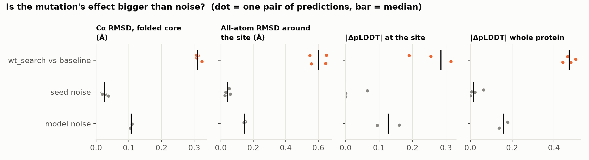

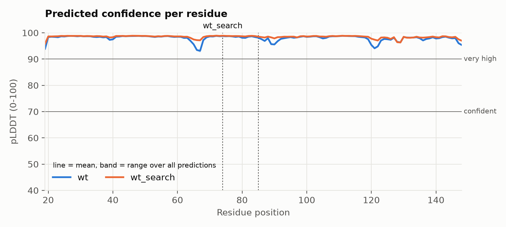

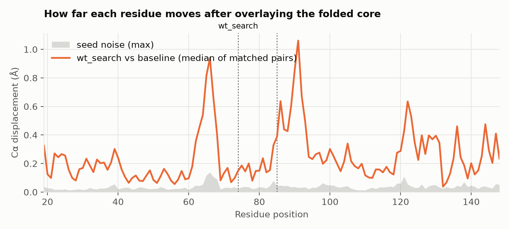

## wt_search: prediction against the crystal structure 1LYY

What the experiment shows: overlaid on 1LZ1, the crystal structure 1LYY differs by 1.94 Å (Cα RMSD), with the largest shift, 9.5 Å, at residue 89. Residues that move more than 2 Å: 63, 64, 65, 66, 67, 68, 86, 87, 88, 89, 90, 91, 121.

What the prediction shows: the largest shift between matched wt and wt_search predictions is 1.06 Å, at residue 91.

| Over the residues that move in the experiment | Median (min-max), Å |
|---|---|
| Shift between the two crystal structures | 6.28 (2.07-9.52) |
| Shift between wt and wt_search predictions | 0.60 (0.41-1.06) |
| Largest seed noise there | 0.05 (0.03-0.14) |
| wt_search predictions, distance from 1LZ1 (wt crystal) | 0.60 (0.59-0.61) |
| wt_search predictions, distance from 1LYY | 6.10 (6.09-6.10) |

| Cα RMSD over the whole protein, median (min-max), Å | vs 1LZ1 (wt crystal) | vs 1LYY |
|---|---|---|
| wt predictions | 0.41 (0.40-0.42) | 1.78 (1.78-1.80) |
| wt_search predictions | 0.26 (0.26-0.27) | 1.92 (1.92-1.92) |

Each prediction, over the residues that move in 1LYY (distance in Å after overlaying the residues that do not move). Verdict for this variant: **stays with the baseline crystal**.

| Network | Seed | From the wt crystal (1LZ1) | From 1LYY | Reading |
|---|---|---|---|---|
| 1 | 0 | 0.60 | 6.10 | stays with the baseline crystal |
| 1 | 1 | 0.59 | 6.10 | stays with the baseline crystal |
| 2 | 0 | 0.61 | 6.09 | stays with the baseline crystal |
| 2 | 1 | 0.60 | 6.09 | stays with the baseline crystal |

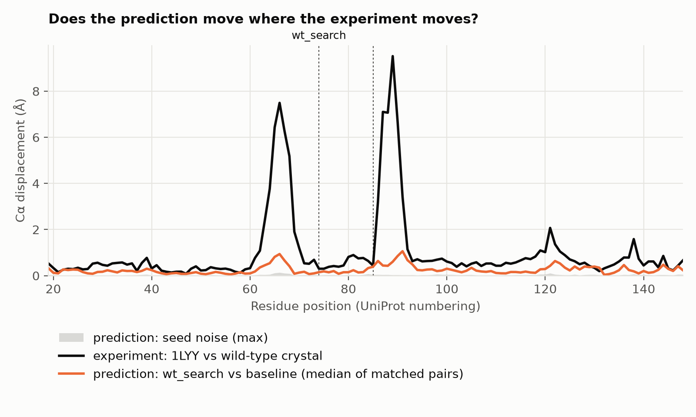

## D67H_search: why this site?

| Residue | Same amino acid in relatives | Most common substitutions | Relatives that carry the new amino acid | Conservation (0-1) | Conservation rank | Exposure to water (0-1) |
|---|---|---|---|---|---|---|
| D85 | 32% | N:14% S:13% P:9% | H: 5.7% | 0.25 | 103 of 130 | 0.20 |

Alignment depth: 5066 unique sequences. Residues within 6.0 Å of the site in 1LZ1: 68, 69, 70, 72, 79, 83, 84, 86, 87, 88, 91, 97, 98, 99.

Closest side-chain approach to known functional residues:

- Catalytic Glu35 and Asp53 (mature numbering): 7.6 Å

## D67H_search vs wt: effect against noise

Decision rule (fixed in advance): the mutation shows up in a metric only if the median over matched pairs is larger than the largest value seen between two seeds of the same sequence. To count as more than detectable it must also exceed the median difference between two of AlphaFold2's networks.

| Metric | Mutation, median (min-max) | Seed noise, median (min-max) | Model noise, median (min-max) | Verdict |
|---|---|---|---|---|
| Cα RMSD, folded core (Å) | 0.33 (0.33-0.34) | 0.03 (0.02-0.04) | 0.11 (0.10-0.11) | **above noise and above the difference between networks** |
| All-atom RMSD around the site (Å) | 0.97 (0.96-0.97) | 0.04 (0.03-0.07) | 0.16 (0.15-0.17) | **above noise and above the difference between networks** |
| \|ΔpLDDT\| at the site | 0.62 (0.44-0.75) | 0.09 (0.00-0.12) | 0.10 (0.07-0.13) | **above noise and above the difference between networks** |
| \|ΔpLDDT\| whole protein | 0.34 (0.31-0.42) | 0.04 (0.01-0.06) | 0.16 (0.14-0.18) | **above noise and above the difference between networks** |

Signed change in pLDDT, D67H_search minus wt (median of matched pairs): -0.62 at the site, +0.34 over the whole protein.

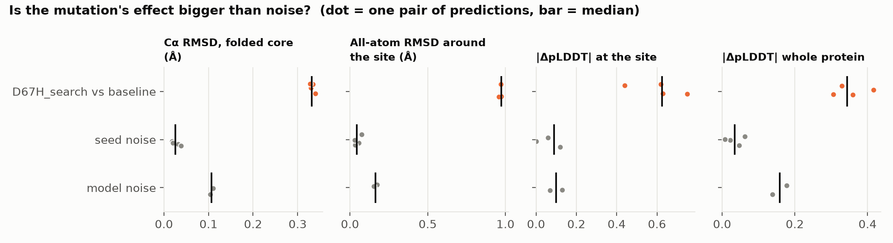

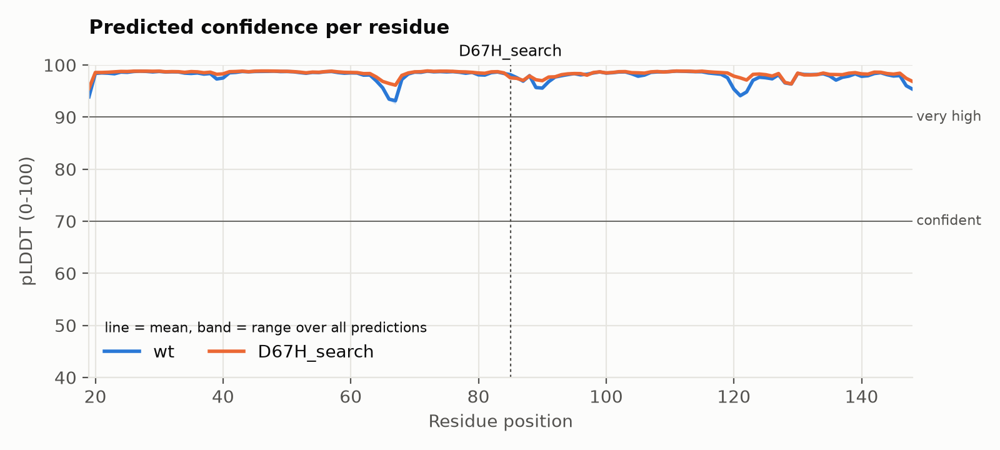

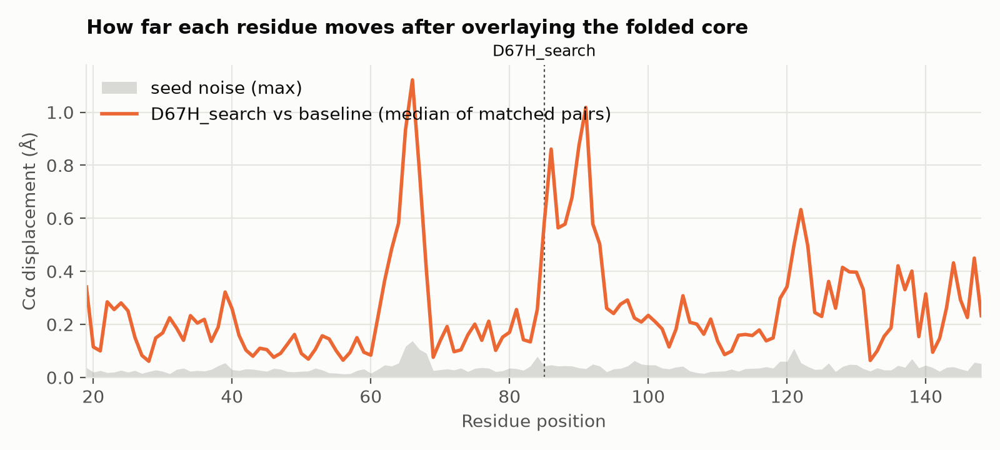

## D67H_search: prediction against the crystal structure 1LYY

What the experiment shows: overlaid on 1LZ1, the crystal structure 1LYY differs by 1.94 Å (Cα RMSD), with the largest shift, 9.5 Å, at residue 89. Residues that move more than 2 Å: 63, 64, 65, 66, 67, 68, 86, 87, 88, 89, 90, 91, 121.

What the prediction shows: the largest shift between matched wt and D67H_search predictions is 1.12 Å, at residue 66.

| Over the residues that move in the experiment | Median (min-max), Å |
|---|---|
| Shift between the two crystal structures | 6.28 (2.07-9.52) |
| Shift between wt and D67H_search predictions | 0.68 (0.41-1.12) |
| Largest seed noise there | 0.05 (0.03-0.14) |
| D67H_search predictions, distance from 1LZ1 (wt crystal) | 0.52 (0.50-0.52) |
| D67H_search predictions, distance from 1LYY | 6.13 (6.13-6.14) |

| Cα RMSD over the whole protein, median (min-max), Å | vs 1LZ1 (wt crystal) | vs 1LYY |
|---|---|---|
| wt predictions | 0.41 (0.40-0.42) | 1.78 (1.78-1.80) |
| D67H_search predictions | 0.24 (0.24-0.25) | 1.93 (1.92-1.93) |

Each prediction, over the residues that move in 1LYY (distance in Å after overlaying the residues that do not move). Verdict for this variant: **stays with the baseline crystal**.

| Network | Seed | From the wt crystal (1LZ1) | From 1LYY | Reading |
|---|---|---|---|---|
| 1 | 0 | 0.50 | 6.13 | stays with the baseline crystal |
| 1 | 1 | 0.51 | 6.14 | stays with the baseline crystal |
| 2 | 0 | 0.52 | 6.13 | stays with the baseline crystal |
| 2 | 1 | 0.52 | 6.13 | stays with the baseline crystal |

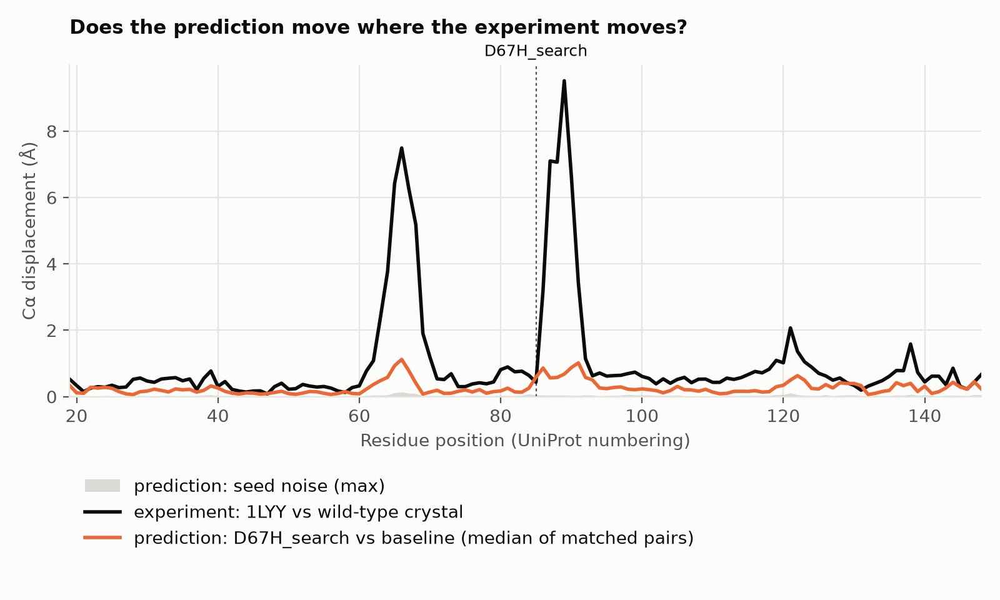

## I56T_search: why this site?

| Residue | Same amino acid in relatives | Most common substitutions | Relatives that carry the new amino acid | Conservation (0-1) | Conservation rank | Exposure to water (0-1) |
|---|---|---|---|---|---|---|
| I74 | 51% | L:43% V:4% M:1% | T: 0.1% | 0.68 | 24 of 130 | 0.01 |

Alignment depth: 5066 unique sequences. Residues within 6.0 Å of the site in 1LZ1: 19, 21, 26, 49, 50, 51, 53, 54, 55, 56, 57, 58, 59, 60, 72, 73, 75, 76, 77, 102, 107, 110.

Closest side-chain approach to known functional residues:

- Catalytic Glu35 and Asp53 (mature numbering): 6.0 Å

## I56T_search vs wt: effect against noise

Decision rule (fixed in advance): the mutation shows up in a metric only if the median over matched pairs is larger than the largest value seen between two seeds of the same sequence. To count as more than detectable it must also exceed the median difference between two of AlphaFold2's networks.

| Metric | Mutation, median (min-max) | Seed noise, median (min-max) | Model noise, median (min-max) | Verdict |
|---|---|---|---|---|
| Cα RMSD, folded core (Å) | 0.30 (0.30-0.32) | 0.03 (0.02-0.04) | 0.11 (0.10-0.11) | **above noise and above the difference between networks** |
| All-atom RMSD around the site (Å) | 0.40 (0.37-0.40) | 0.03 (0.02-0.06) | 0.13 (0.13-0.13) | **above noise and above the difference between networks** |
| \|ΔpLDDT\| at the site | 0.09 (0.06-0.13) | 0.03 (0.00-0.07) | 0.15 (0.12-0.19) | **detectable but smaller than the difference between networks** |
| \|ΔpLDDT\| whole protein | 0.46 (0.44-0.50) | 0.02 (0.00-0.06) | 0.16 (0.14-0.18) | **above noise and above the difference between networks** |

Signed change in pLDDT, I56T_search minus wt (median of matched pairs): -0.09 at the site, +0.46 over the whole protein.

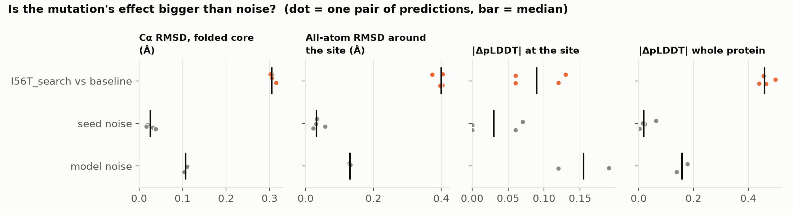

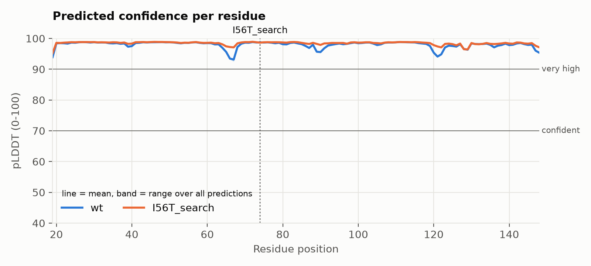

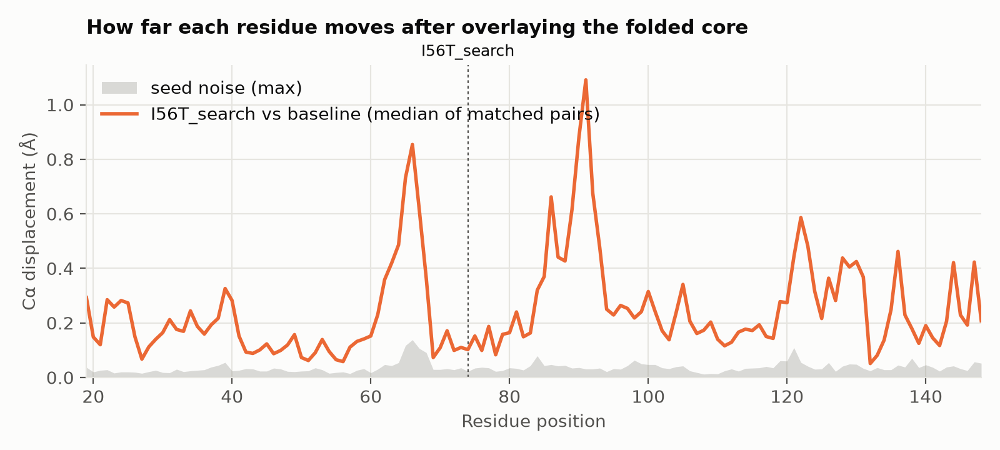

## wt_1LZ1: why this site?

| Residue | Same amino acid in relatives | Most common substitutions | Relatives that carry the new amino acid | Conservation (0-1) | Conservation rank | Exposure to water (0-1) |
|---|---|---|---|---|---|---|

Alignment depth: 5066 unique sequences. Residues within 6.0 Å of the site in 1LZ1: 19, 21, 26, 49, 50, 51, 53, 54, 55, 56, 57, 58, 59, 60, 68, 69, 70, 72, 73, 75, 76, 77, 79, 83, 84, 86, 87, 88, 91, 97, 98, 99, 102, 107, 110.

Closest side-chain approach to known functional residues:

- Catalytic Glu35 and Asp53 (mature numbering): 6.0 Å

## wt_1LZ1 vs wt: effect against noise

Decision rule (fixed in advance): the mutation shows up in a metric only if the median over matched pairs is larger than the largest value seen between two seeds of the same sequence. To count as more than detectable it must also exceed the median difference between two of AlphaFold2's networks.

| Metric | Mutation, median (min-max) | Seed noise, median (min-max) | Model noise, median (min-max) | Verdict |
|---|---|---|---|---|
| Cα RMSD, folded core (Å) | 0.26 (0.24-0.28) | 0.03 (0.02-0.04) | 0.11 (0.10-0.11) | **above noise and above the difference between networks** |
| All-atom RMSD around the site (Å) | 0.50 (0.48-0.51) | 0.04 (0.03-0.06) | 0.15 (0.14-0.15) | **above noise and above the difference between networks** |
| \|ΔpLDDT\| at the site | 0.24 (0.16-0.25) | 0.00 (0.00-0.07) | 0.13 (0.10-0.16) | **above noise and above the difference between networks** |
| \|ΔpLDDT\| whole protein | 0.36 (0.35-0.42) | 0.02 (0.00-0.06) | 0.16 (0.14-0.18) | **above noise and above the difference between networks** |

Signed change in pLDDT, wt_1LZ1 minus wt (median of matched pairs): +0.24 at the site, +0.36 over the whole protein.

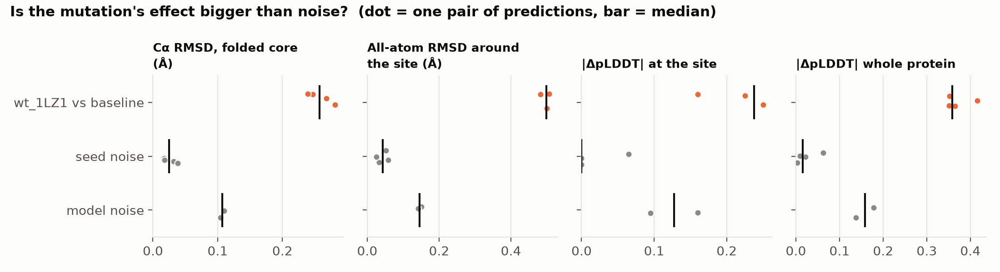

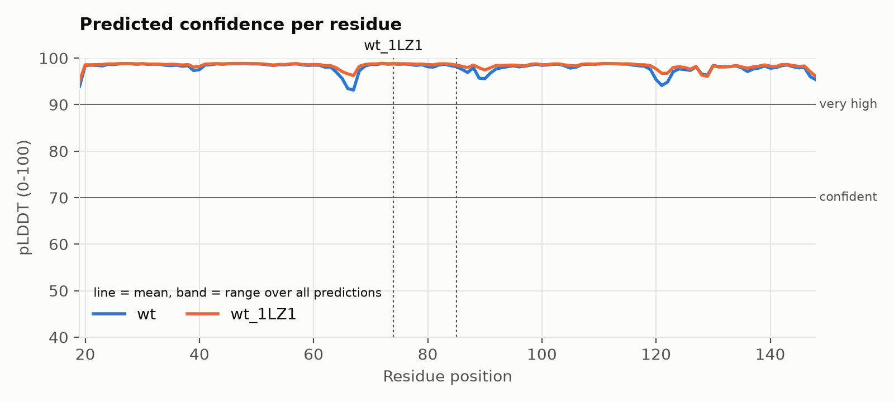

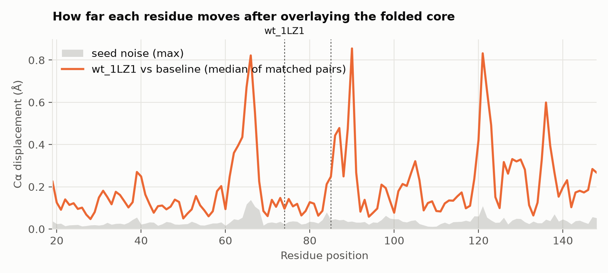

## wt_1LZ1: prediction against the crystal structure 1LYY

What the experiment shows: overlaid on 1LZ1, the crystal structure 1LYY differs by 1.94 Å (Cα RMSD), with the largest shift, 9.5 Å, at residue 89. Residues that move more than 2 Å: 63, 64, 65, 66, 67, 68, 86, 87, 88, 89, 90, 91, 121.

What the prediction shows: the largest shift between matched wt and wt_1LZ1 predictions is 0.85 Å, at residue 90.

| Over the residues that move in the experiment | Median (min-max), Å |
|---|---|
| Shift between the two crystal structures | 6.28 (2.07-9.52) |
| Shift between wt and wt_1LZ1 predictions | 0.47 (0.23-0.85) |
| Largest seed noise there | 0.05 (0.03-0.14) |
| wt_1LZ1 predictions, distance from 1LZ1 (wt crystal) | 0.42 (0.38-0.46) |
| wt_1LZ1 predictions, distance from 1LYY | 5.97 (5.93-6.01) |

| Cα RMSD over the whole protein, median (min-max), Å | vs 1LZ1 (wt crystal) | vs 1LYY |
|---|---|---|
| wt predictions | 0.41 (0.40-0.42) | 1.78 (1.78-1.80) |
| wt_1LZ1 predictions | 0.20 (0.20-0.22) | 1.89 (1.87-1.90) |

Each prediction, over the residues that move in 1LYY (distance in Å after overlaying the residues that do not move). Verdict for this variant: **stays with the baseline crystal**.

| Network | Seed | From the wt crystal (1LZ1) | From 1LYY | Reading |
|---|---|---|---|---|
| 1 | 0 | 0.39 | 6.01 | stays with the baseline crystal |
| 1 | 1 | 0.38 | 6.01 | stays with the baseline crystal |
| 2 | 0 | 0.46 | 5.93 | stays with the baseline crystal |
| 2 | 1 | 0.46 | 5.93 | stays with the baseline crystal |

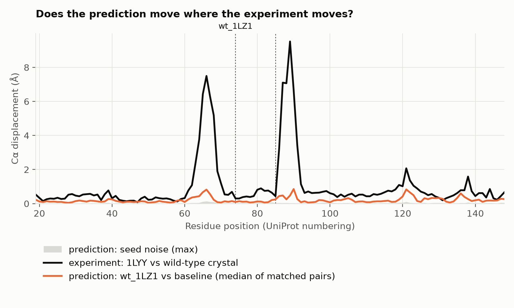

## D67H_1LZ1: why this site?

| Residue | Same amino acid in relatives | Most common substitutions | Relatives that carry the new amino acid | Conservation (0-1) | Conservation rank | Exposure to water (0-1) |
|---|---|---|---|---|---|---|
| D85 | 32% | N:14% S:13% P:9% | H: 5.7% | 0.25 | 103 of 130 | 0.20 |

Alignment depth: 5066 unique sequences. Residues within 6.0 Å of the site in 1LZ1: 68, 69, 70, 72, 79, 83, 84, 86, 87, 88, 91, 97, 98, 99.

Closest side-chain approach to known functional residues:

- Catalytic Glu35 and Asp53 (mature numbering): 7.6 Å

## D67H_1LZ1 vs wt: effect against noise

Decision rule (fixed in advance): the mutation shows up in a metric only if the median over matched pairs is larger than the largest value seen between two seeds of the same sequence. To count as more than detectable it must also exceed the median difference between two of AlphaFold2's networks.

| Metric | Mutation, median (min-max) | Seed noise, median (min-max) | Model noise, median (min-max) | Verdict |
|---|---|---|---|---|
| Cα RMSD, folded core (Å) | 0.28 (0.26-0.29) | 0.03 (0.02-0.04) | 0.11 (0.10-0.11) | **above noise and above the difference between networks** |
| All-atom RMSD around the site (Å) | 0.93 (0.92-0.94) | 0.05 (0.03-0.07) | 0.16 (0.15-0.17) | **above noise and above the difference between networks** |
| \|ΔpLDDT\| at the site | 0.78 (0.56-0.94) | 0.06 (0.00-0.06) | 0.10 (0.07-0.13) | **above noise and above the difference between networks** |
| \|ΔpLDDT\| whole protein | 0.23 (0.17-0.32) | 0.03 (0.01-0.06) | 0.16 (0.14-0.18) | **above noise and above the difference between networks** |

Signed change in pLDDT, D67H_1LZ1 minus wt (median of matched pairs): -0.78 at the site, +0.23 over the whole protein.

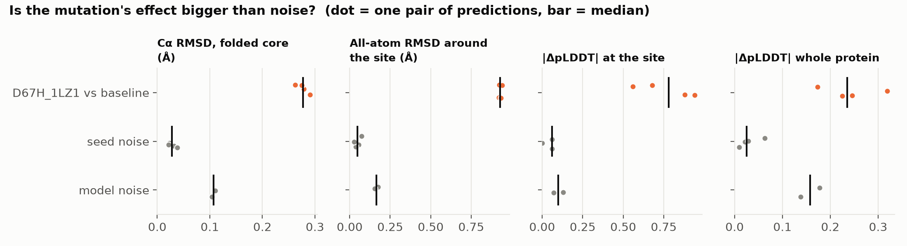

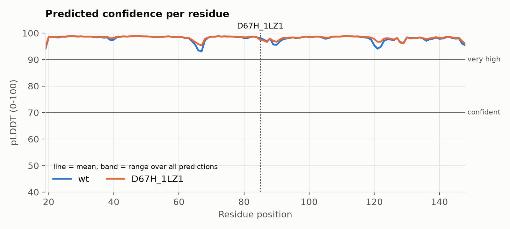

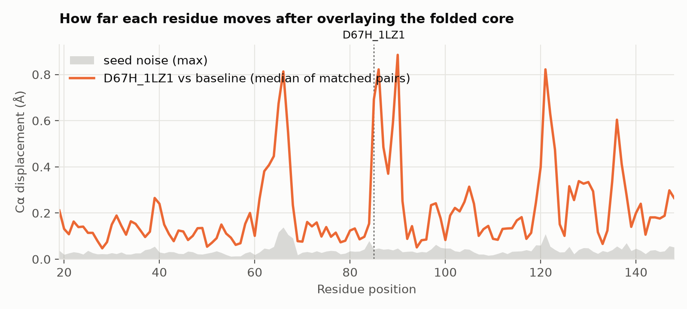

## D67H_1LZ1: prediction against the crystal structure 1LYY

What the experiment shows: overlaid on 1LZ1, the crystal structure 1LYY differs by 1.94 Å (Cα RMSD), with the largest shift, 9.5 Å, at residue 89. Residues that move more than 2 Å: 63, 64, 65, 66, 67, 68, 86, 87, 88, 89, 90, 91, 121.

What the prediction shows: the largest shift between matched wt and D67H_1LZ1 predictions is 0.88 Å, at residue 90.

| Over the residues that move in the experiment | Median (min-max), Å |
|---|---|
| Shift between the two crystal structures | 6.28 (2.07-9.52) |
| Shift between wt and D67H_1LZ1 predictions | 0.55 (0.23-0.89) |
| Largest seed noise there | 0.05 (0.03-0.14) |
| D67H_1LZ1 predictions, distance from 1LZ1 (wt crystal) | 0.39 (0.35-0.40) |
| D67H_1LZ1 predictions, distance from 1LYY | 6.01 (5.97-6.05) |

| Cα RMSD over the whole protein, median (min-max), Å | vs 1LZ1 (wt crystal) | vs 1LYY |
|---|---|---|
| wt predictions | 0.41 (0.40-0.42) | 1.78 (1.78-1.80) |
| D67H_1LZ1 predictions | 0.20 (0.20-0.21) | 1.90 (1.89-1.91) |

Each prediction, over the residues that move in 1LYY (distance in Å after overlaying the residues that do not move). Verdict for this variant: **stays with the baseline crystal**.

| Network | Seed | From the wt crystal (1LZ1) | From 1LYY | Reading |
|---|---|---|---|---|
| 1 | 0 | 0.38 | 6.05 | stays with the baseline crystal |
| 1 | 1 | 0.35 | 6.05 | stays with the baseline crystal |
| 2 | 0 | 0.40 | 5.98 | stays with the baseline crystal |
| 2 | 1 | 0.40 | 5.98 | stays with the baseline crystal |

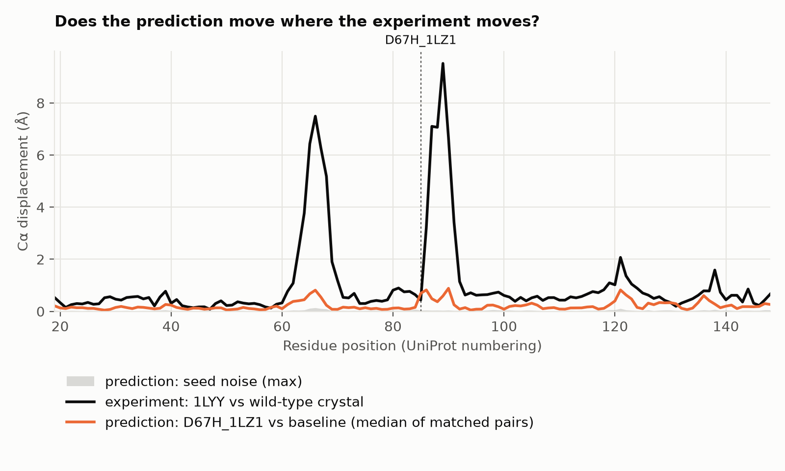

## wt_1LYY: why this site?

| Residue | Same amino acid in relatives | Most common substitutions | Relatives that carry the new amino acid | Conservation (0-1) | Conservation rank | Exposure to water (0-1) |
|---|---|---|---|---|---|---|

Alignment depth: 5066 unique sequences. Residues within 6.0 Å of the site in 1LZ1: 19, 21, 26, 49, 50, 51, 53, 54, 55, 56, 57, 58, 59, 60, 68, 69, 70, 72, 73, 75, 76, 77, 79, 83, 84, 86, 87, 88, 91, 97, 98, 99, 102, 107, 110.

Closest side-chain approach to known functional residues:

- Catalytic Glu35 and Asp53 (mature numbering): 6.0 Å

## wt_1LYY vs wt: effect against noise

Decision rule (fixed in advance): the mutation shows up in a metric only if the median over matched pairs is larger than the largest value seen between two seeds of the same sequence. To count as more than detectable it must also exceed the median difference between two of AlphaFold2's networks.

| Metric | Mutation, median (min-max) | Seed noise, median (min-max) | Model noise, median (min-max) | Verdict |
|---|---|---|---|---|
| Cα RMSD, folded core (Å) | 0.25 (0.23-0.28) | 0.03 (0.02-0.04) | 0.11 (0.10-0.11) | **above noise and above the difference between networks** |
| All-atom RMSD around the site (Å) | 0.45 (0.38-0.50) | 0.05 (0.04-0.06) | 0.15 (0.14-0.15) | **above noise and above the difference between networks** |
| \|ΔpLDDT\| at the site | 0.15 (0.10-0.34) | 0.03 (0.00-0.07) | 0.13 (0.10-0.16) | **above noise and above the difference between networks** |
| \|ΔpLDDT\| whole protein | 0.15 (0.10-0.20) | 0.03 (0.01-0.06) | 0.16 (0.14-0.18) | **detectable but smaller than the difference between networks** |

Signed change in pLDDT, wt_1LYY minus wt (median of matched pairs): -0.15 at the site, -0.15 over the whole protein.

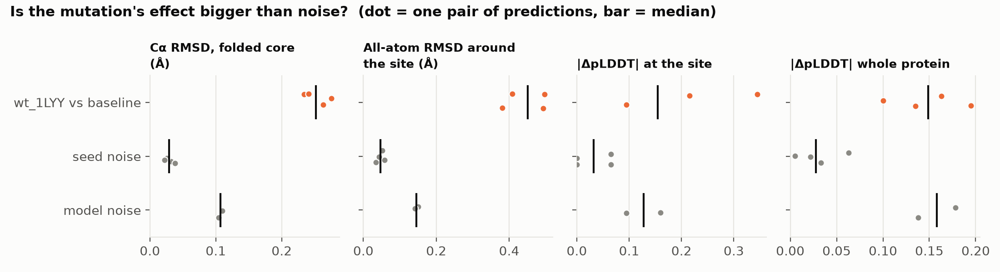

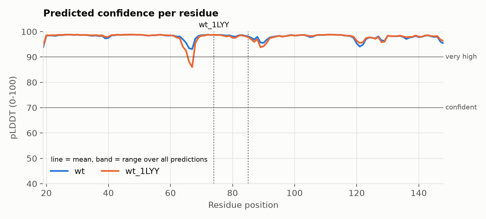

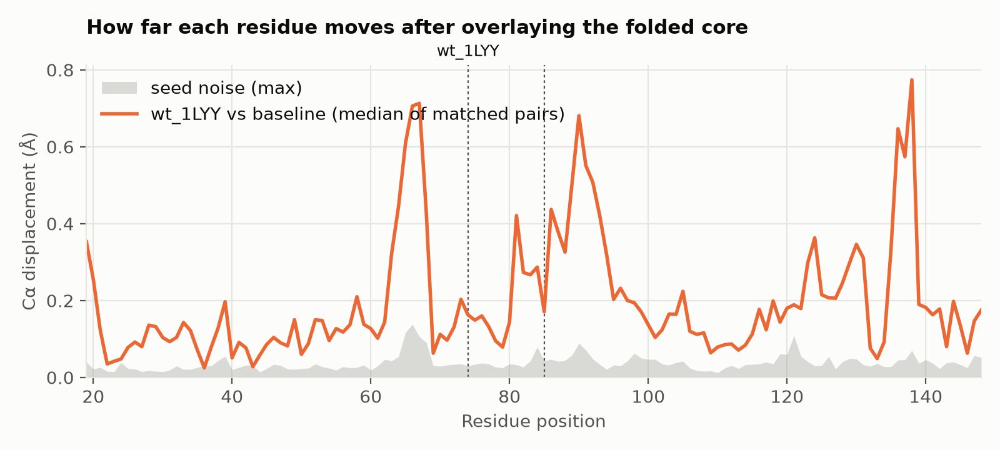

## wt_1LYY: prediction against the crystal structure 1LYY

What the experiment shows: overlaid on 1LZ1, the crystal structure 1LYY differs by 1.94 Å (Cα RMSD), with the largest shift, 9.5 Å, at residue 89. Residues that move more than 2 Å: 63, 64, 65, 66, 67, 68, 86, 87, 88, 89, 90, 91, 121.

What the prediction shows: the largest shift between matched wt and wt_1LYY predictions is 0.77 Å, at residue 138.

| Over the residues that move in the experiment | Median (min-max), Å |
|---|---|
| Shift between the two crystal structures | 6.28 (2.07-9.52) |
| Shift between wt and wt_1LYY predictions | 0.45 (0.19-0.71) |
| Largest seed noise there | 0.07 (0.04-0.14) |
| wt_1LYY predictions, distance from 1LZ1 (wt crystal) | 1.40 (1.34-1.44) |
| wt_1LYY predictions, distance from 1LYY | 5.26 (5.24-5.29) |

| Cα RMSD over the whole protein, median (min-max), Å | vs 1LZ1 (wt crystal) | vs 1LYY |
|---|---|---|
| wt predictions | 0.41 (0.40-0.42) | 1.78 (1.78-1.80) |
| wt_1LYY predictions | 0.53 (0.51-0.54) | 1.65 (1.64-1.65) |

Each prediction, over the residues that move in 1LYY (distance in Å after overlaying the residues that do not move). Verdict for this variant: **stays with the baseline crystal**.

| Network | Seed | From the wt crystal (1LZ1) | From 1LYY | Reading |
|---|---|---|---|---|
| 1 | 0 | 1.44 | 5.26 | stays with the baseline crystal |
| 1 | 1 | 1.44 | 5.24 | stays with the baseline crystal |
| 2 | 0 | 1.34 | 5.29 | stays with the baseline crystal |
| 2 | 1 | 1.36 | 5.27 | stays with the baseline crystal |

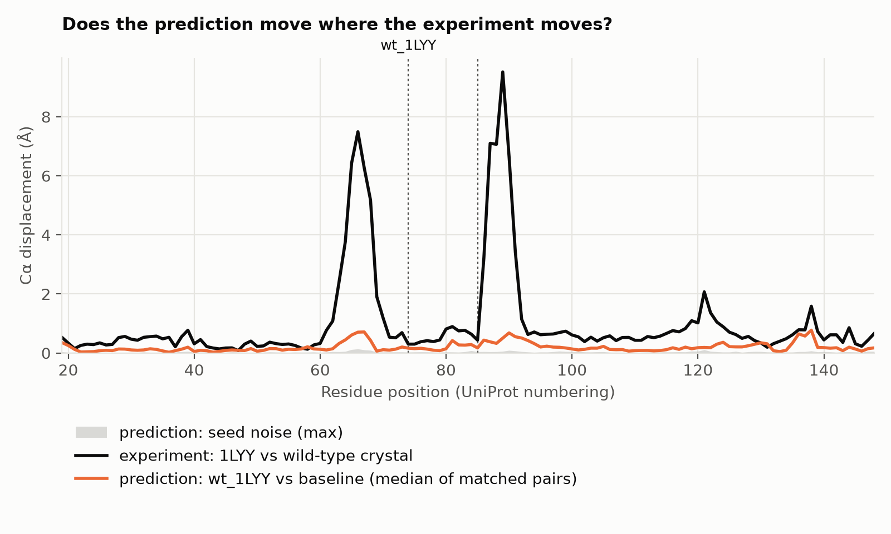

## D67H_1LYY: why this site?

| Residue | Same amino acid in relatives | Most common substitutions | Relatives that carry the new amino acid | Conservation (0-1) | Conservation rank | Exposure to water (0-1) |
|---|---|---|---|---|---|---|
| D85 | 32% | N:14% S:13% P:9% | H: 5.7% | 0.25 | 103 of 130 | 0.20 |

Alignment depth: 5066 unique sequences. Residues within 6.0 Å of the site in 1LZ1: 68, 69, 70, 72, 79, 83, 84, 86, 87, 88, 91, 97, 98, 99.

Closest side-chain approach to known functional residues:

- Catalytic Glu35 and Asp53 (mature numbering): 7.6 Å

## D67H_1LYY vs wt: effect against noise

Decision rule (fixed in advance): the mutation shows up in a metric only if the median over matched pairs is larger than the largest value seen between two seeds of the same sequence. To count as more than detectable it must also exceed the median difference between two of AlphaFold2's networks.

| Metric | Mutation, median (min-max) | Seed noise, median (min-max) | Model noise, median (min-max) | Verdict |
|---|---|---|---|---|
| Cα RMSD, folded core (Å) | 0.26 (0.25-0.27) | 0.03 (0.02-0.04) | 0.11 (0.10-0.11) | **above noise and above the difference between networks** |
| All-atom RMSD around the site (Å) | 0.86 (0.64-0.88) | 0.07 (0.04-0.63) | 0.16 (0.15-0.17) | **above noise and above the difference between networks** |
| \|ΔpLDDT\| at the site | 4.81 (4.74-5.75) | 0.10 (0.00-0.94) | 0.10 (0.07-0.13) | **above noise and above the difference between networks** |
| \|ΔpLDDT\| whole protein | 0.61 (0.52-0.75) | 0.04 (0.01-0.14) | 0.16 (0.14-0.18) | **above noise and above the difference between networks** |

Signed change in pLDDT, D67H_1LYY minus wt (median of matched pairs): -4.81 at the site, -0.61 over the whole protein.

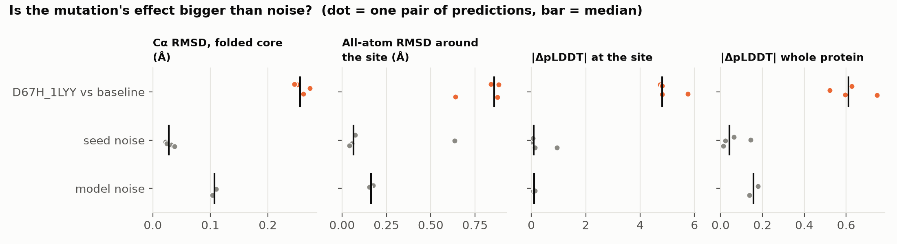

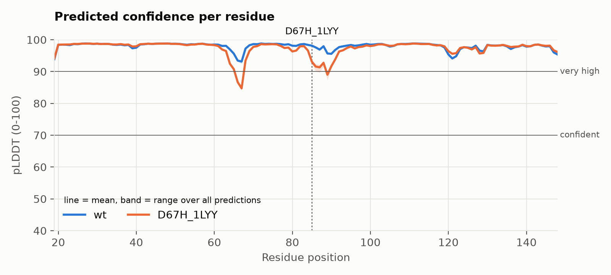

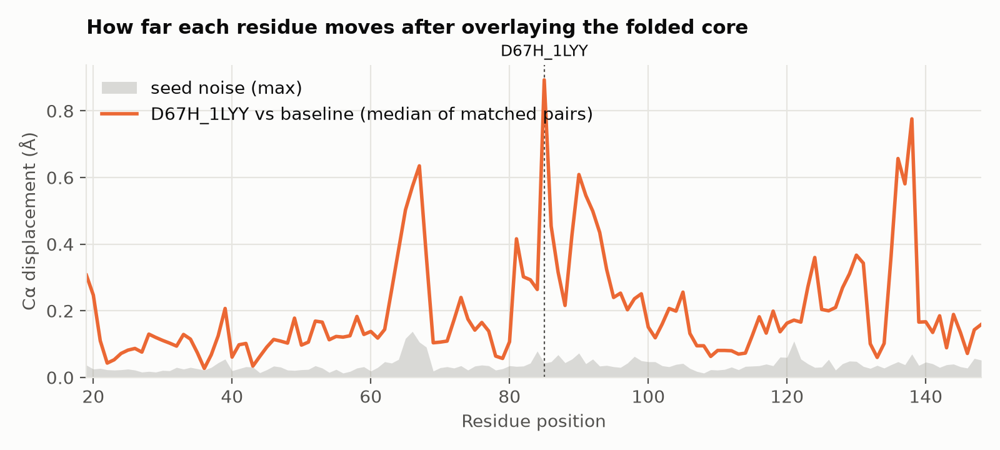

## D67H_1LYY: prediction against the crystal structure 1LYY

What the experiment shows: overlaid on 1LZ1, the crystal structure 1LYY differs by 1.94 Å (Cα RMSD), with the largest shift, 9.5 Å, at residue 89. Residues that move more than 2 Å: 63, 64, 65, 66, 67, 68, 86, 87, 88, 89, 90, 91, 121.

What the prediction shows: the largest shift between matched wt and D67H_1LYY predictions is 0.89 Å, at residue 85.

| Over the residues that move in the experiment | Median (min-max), Å |
|---|---|
| Shift between the two crystal structures | 6.28 (2.07-9.52) |
| Shift between wt and D67H_1LYY predictions | 0.43 (0.17-0.64) |
| Largest seed noise there | 0.07 (0.04-0.14) |
| D67H_1LYY predictions, distance from 1LZ1 (wt crystal) | 1.28 (1.24-1.33) |
| D67H_1LYY predictions, distance from 1LYY | 5.32 (5.31-5.33) |

| Cα RMSD over the whole protein, median (min-max), Å | vs 1LZ1 (wt crystal) | vs 1LYY |
|---|---|---|
| wt predictions | 0.41 (0.40-0.42) | 1.78 (1.78-1.80) |
| D67H_1LYY predictions | 0.50 (0.49-0.52) | 1.66 (1.66-1.67) |

Each prediction, over the residues that move in 1LYY (distance in Å after overlaying the residues that do not move). Verdict for this variant: **stays with the baseline crystal**.

| Network | Seed | From the wt crystal (1LZ1) | From 1LYY | Reading |
|---|---|---|---|---|
| 1 | 0 | 1.31 | 5.33 | stays with the baseline crystal |
| 1 | 1 | 1.33 | 5.32 | stays with the baseline crystal |
| 2 | 0 | 1.25 | 5.31 | stays with the baseline crystal |
| 2 | 1 | 1.24 | 5.32 | stays with the baseline crystal |

## Sequence against template

Which crystal the moved residues of each variant's predictions resemble.

| Variant | Mutations | Template handed over | Scored against | Verdict |
|---|---|---|---|---|
| wt | none | none | - | - |
| D67H | D85H | none | 1LYY | stays with the baseline crystal |
| I56T | I74T | none | - | - |
| wt_search | none | database search | 1LYY | stays with the baseline crystal |
| D67H_search | D85H | database search | 1LYY | stays with the baseline crystal |
| I56T_search | I74T | database search | - | - |
| wt_1LZ1 | none | 1LZ1 | 1LYY | stays with the baseline crystal |
| D67H_1LZ1 | D85H | 1LZ1 | 1LYY | stays with the baseline crystal |
| wt_1LYY | none | 1LYY | 1LYY | stays with the baseline crystal |
| D67H_1LYY | D85H | 1LYY | 1LYY | stays with the baseline crystal |

## Provenance

- ColabFold 1.6.3, AlphaFold2 weights `alphafold_params_2021-07-14 (AlphaFold2-ptm)`, JAX 0.11.2, Python 3.12.16, macOS-26.4.1-arm64-arm-64bit
- Settings: model_type=alphafold2_ptm, msa_mode=mmseqs2_uniref_env, models=[1, 2], num_recycle=3, num_seeds=2, random_seed=0
- Every variant used the same alignment; only the query row differs (see `msa/`).
- 3D view: open `results/viewer.html` in a browser.
